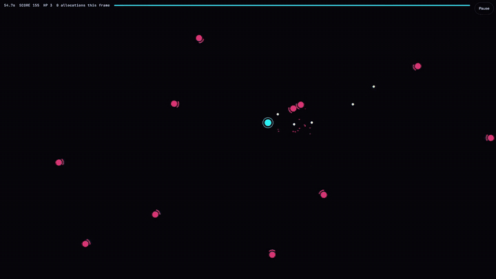
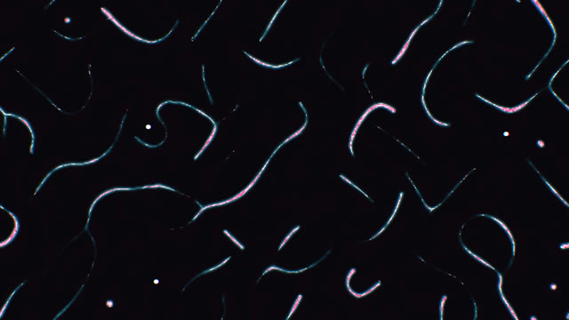
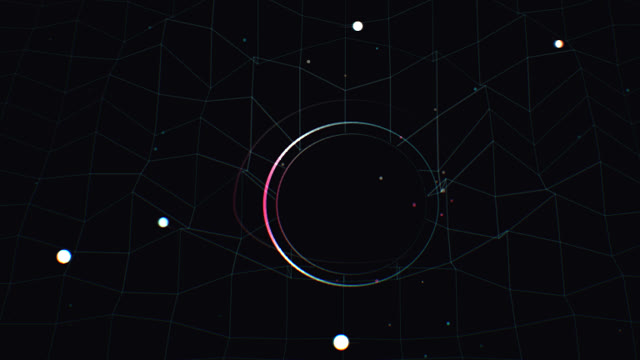
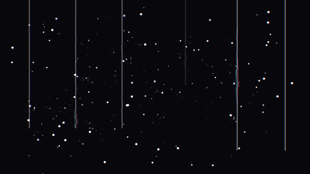
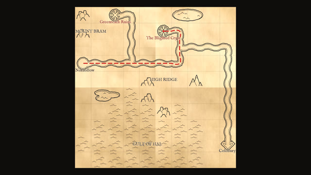
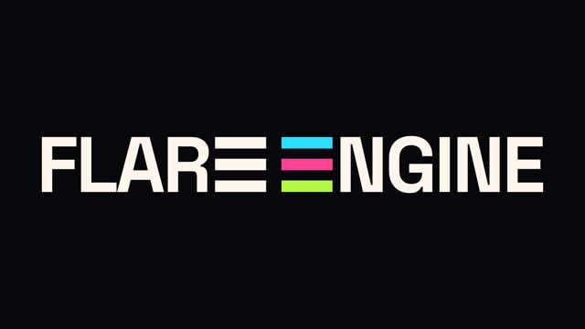
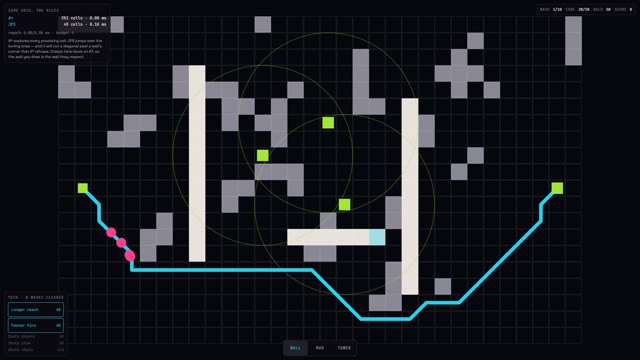

<h1 align="center">
  <picture>
    <source media="(prefers-color-scheme: dark)" srcset="docs/assets/readme/wordmark-on-dark.svg">
    
  </picture>
</h1>

<p align="center"><strong>Open-source 2D engine for React Native and the web</strong></p>

<p align="center">
  <a href="https://github.com/grzott/flare-engine/actions/workflows/ci.yml"></a>
  <a href="https://www.npmjs.com/package/@flare-engine/engine"></a>
  <a href="./LICENSE"></a>
  <a href="./tsconfig.base.json"></a>
</p>

<p align="center">
  <a href="https://flareengine.dev/showcases/"><strong>Showcases</strong></a> ·
  <a href="https://flareengine.dev/guides/overview/"><strong>Docs</strong></a> ·
  <a href="https://flareengine.dev/getting-started/"><strong>Getting started</strong></a> ·
  <a href="https://github.com/grzott/flare-engine/discussions"><strong>Discussions</strong></a>
</p>

<p align="center">
  <a href="https://flareengine.dev/showcases/"></a>
</p>

Flare is a set of TypeScript packages for animation, particles, physics, gamification and small
games. The same code renders through [React Native Skia](https://shopify.github.io/react-native-skia/)
on phones and through CanvasKit in the browser. Use the whole engine, or take one package into the app
you already have.

**Try it in your browser, no install:** [flareengine.dev/showcases](https://flareengine.dev/showcases/)
runs three playable demos and five animations on the published packages.

## Quick start

```bash
npm create @flare-engine my-game   # templates: blank, topdown, shmup
```

The templates are Expo apps. They need a development build rather than Expo Go, and `bun run web`
runs the same game in the browser. Pick a template with `-- --template <name>`; with bun, use
`bunx @flare-engine/create my-game`. (`npm create flare-app` is a different, unrelated package.)

Or add one package to an existing app:

```bash
npm install @flare-engine/progression
```

```ts
import { createUpgradeTrack, resolveTier } from '@flare-engine/progression';

const track = createUpgradeTrack({ base: 500, growth: 1.5, cap: 10 });
const price = track.price(3); // 1688, i.e. round(500 * 1.5^3)
const tier = resolveTier([{ at: 1, tier: 'bronze' }, { at: 10, tier: 'silver' }], 5); // 'bronze'
```

Every package README carries its own example, and CI typechecks all of them.

## What you can build

<table>
  <tr>
    <td align="center" width="33%"><a href="https://flareengine.dev/showcases/physarum-network/"></a><br><sub><b>Physarum network</b> · slime-mould transport<br><code>@flare-engine/simulation</code></sub></td>
    <td align="center" width="33%"><a href="https://flareengine.dev/showcases/spacetime-lattice/"></a><br><sub><b>Spacetime lattice</b> · N-body merger<br><code>@flare-engine/simulation</code></sub></td>
    <td align="center" width="33%"><a href="https://flareengine.dev/showcases/nuclear-reaction/"></a><br><sub><b>Nuclear reactor</b> · emergent chain reaction<br><code>@flare-engine/ecs</code></sub></td>
  </tr>
  <tr>
    <td align="center"><a href="https://flareengine.dev/showcases/map/"></a><br><sub><b>Procedural map</b> · seeded cartography<br><code>@flare-engine/pathfinding</code></sub></td>
    <td align="center"><a href="https://flareengine.dev/showcases/logo/"></a><br><sub><b>Logo reveal</b> · hand-written shader<br><code>@flare-engine/postfx</code></sub></td>
    <td align="center"><a href="https://flareengine.dev/showcases/reroute/"></a><br><sub><b>Reroute</b> · playable tower defense<br><code>@flare-engine/pathfinding</code></sub></td>
  </tr>
</table>

Each tile opens the live demo. Most have a guide that rebuilds them from first principles.

## Why Flare

- **One codebase, two renderers.** React Native Skia on device, CanvasKit in the browser.
- **Take only what you need.** 42 tree-shakeable packages on a strict downward-only dependency graph,
  all on one lockstep version.
- **Built for the frame budget.** Zero-allocation hot paths, and sprites batched through Skia's Atlas
  API.
- **Gates, not promises.** CI typechecks every package README example, and a steady-state particle
  emitter that allocates fails the build.

## Platform status

| Platform                                                      | Status                     |
| ------------------------------------------------------------- | -------------------------- |
| React Native on a real Android device                         | verified                   |
| React Native on iOS                                           | not yet tested on a device |
| Web: desktop Chrome and Firefox, Android Chrome on a Pixel 7   | verified                   |
| Web: Safari and iOS Safari                                    | not yet verified           |

The React Native path requires the New Architecture (Reanimated 4). The browser runs are recorded in
the [manual test protocol](docs/plans/manual-test-protocol.md).

## Project status

**Open source since October 2026.** Every `@flare-engine/*` package is public on npm, and releases
from `0.4.5` on are published from CI with npm provenance.

- 42 scoped `@flare-engine/*` packages, scaffolder included, versioned in **lockstep**: one shared
  version across the whole scope, cut together with Changesets.
- Real consumers, not just a workspace: the demos on [flareengine.dev](https://flareengine.dev) run on
  the published packages in the browser, and Pan Tvardowski, a private, unreleased game in alpha,
  consumes the engine from npm on a real Android device.
- Not affiliated with [FLARE (flarerpg.org)](https://flarerpg.org), a separate action-RPG game
  engine. This project is the `@flare-engine/*` TypeScript packages for React Native and the web.
- Roadmap: [docs/plans/roadmap.md](docs/plans/roadmap.md)

## How this is built

Flare is built with an **AI-directed agent workflow**: the implementation is written by coding
agents, and the architecture, decisions, gates and review are the author's. Scoped builder agents
work from a written queue and cannot commit — that is enforced in the harness, not by convention —
and a gate is only accepted once it has been proven able to fail.

This is stated because it changes how to read the repository: the commit history is dense, and the
docs are unusually explicit about their own past errors. Both are artifacts of the method. It is not
code generated from a prompt and shipped unread; the engineering is in the decisions, the contracts
and the verification. See [CONTRIBUTING.md](CONTRIBUTING.md#how-this-is-built) for what that means
for a contributor.

## Packages

<details>
<summary><b>All 42 packages, by area</b></summary>

### Start here

| Package | Status | Description |
| --- | --- | --- |
| `@flare-engine/engine` | shipping | `createGame()` convenience + umbrella re-exports |
| `@flare-engine/react` | shipping | `<GameView>`, hooks, `<VirtualJoystick>`, `<VirtualButton>`, `<LoadingScreen>` |
| `@flare-engine/render-web` | shipping | Web analog of `react` — composes `render` + `postfx` via CanvasKit-WASM |
| `@flare-engine/create` | shipping | `npm create @flare-engine` — blank / topdown / shmup templates |
| `@flare-engine/cli` | shipping | `flare pack-atlas`, `flare tiled-to-flare`, `flare new` |

### Core and ECS

| Package | Status | Description |
| --- | --- | --- |
| `@flare-engine/math` | shipping | Vec2, Rect, Transform, Mat3, Color, Penner easings, seeded RNG, intersections |
| `@flare-engine/events` | shipping | Type-safe `EventEmitter` and `Signal` |
| `@flare-engine/core` | shipping | `GameLoop`, `Clock`, `AppLifecycle`, `ScreenManager`, coroutines, pool |
| `@flare-engine/ecs` | shipping | Archetype-bitmask ECS — `World`, `Query`, systems, prefabs, FSM (32-type cap) |
| `@flare-engine/scene` | shipping | `SceneManager`, lifecycle, fade/slide transitions |
| `@flare-engine/input` | shipping | `InputManager`, pointer/touch, gestures, joystick/button state |
| `@flare-engine/assets` | shipping | `AssetManager`, TexturePacker/Aseprite parser, procedural atlas |
| `@flare-engine/audio` | shipping | `AudioManager`, `SFXPool`, music crossfade, channels |

### Rendering and motion

| Package | Status | Description |
| --- | --- | --- |
| `@flare-engine/render` | shipping | Skia Atlas `SpriteBatch`, `Camera2D`, sprite effects, BMFont text |
| `@flare-engine/postfx` | shipping | Skia RuntimeEffect stack: CRT, bloom, vignette, grayscale-flash |
| `@flare-engine/particles` | shipping | Pooled emitters, immediate-mode Skia rendering |
| `@flare-engine/shapes` | shipping | Procedural 2D shape primitives + SVG path escape hatch — prototype without art |
| `@flare-engine/animation` | shipping | Sprite animator, tweens (Penner easings), springs, timelines |
| `@flare-engine/ui` | shipping | Skia-free UI kit: Panel / Button / Label / List / Modal / HUDBar + focus nav |

### Worlds and simulation

| Package | Status | Description |
| --- | --- | --- |
| `@flare-engine/dynamics` | shipping | 2D rigid bodies — OBB contact manifolds, sequential-impulse solver, friction |
| `@flare-engine/physics` | shipping | AABB `CollisionWorld`, spatial index, raycasting |
| `@flare-engine/simulation` | shipping | N-body gravity, Verlet/leapfrog integrators, wave-packet ripple pool |
| `@flare-engine/pathfinding` | beta — no production consumer | A\* grid + JPS + convex-polygon navmesh (no flow fields). A\* and JPS differ on corner cutting; JPS delegates to A\* on weighted grids — see the package README |
| `@flare-engine/tilemap` | shipping | Tiled `.tmj` + LDtk parsers, culled renderer, collider extraction |
| `@flare-engine/dialogue` | shipping | Branching dialogue graph, runtime evaluator |

### Gamification and monetization

| Package | Status | Description |
| --- | --- | --- |
| `@flare-engine/progression` | shipping | Upgrade tracks, pity-aware drop tables, unlock DAG, tier + collectible registry |
| `@flare-engine/achievements` | shipping | Interface + no-op + in-memory / storage-backed providers; platform adapters post-launch |
| `@flare-engine/leaderboards` | shipping | Interface + no-op + in-memory provider (`createMemoryLeaderboards`); platform adapters post-launch |
| `@flare-engine/analytics` | shipping | Interface + no-op + in-memory + console providers; vendor adapters post-launch |
| `@flare-engine/iap` | shipping | Interface + no-op provider + `ProductCatalog` + `EntitlementStore` + content gates |
| `@flare-engine/iap-revenuecat` | shipping | Concrete RevenueCat `IAPProvider` adapter (lazy `react-native-purchases`) |
| `@flare-engine/ui-shop` | shipping | `ShopScreen` + `PaywallModal` + `RestorePurchasesButton` consuming `IAPContext` |

### App services

| Package | Status | Description |
| --- | --- | --- |
| `@flare-engine/storage` | shipping | Typed KV persistence — MMKV / IndexedDB / memory adapters |
| `@flare-engine/errors` | shipping | Error boundary + structured crash payload + pluggable transport |
| `@flare-engine/a11y` | shipping (light) | Reduced-motion + contrast tokens (screen-reader deferred) |
| `@flare-engine/haptics` | shipping | `HapticsProvider` interface + Noop / Expo / Web-Vibration providers + context |
| `@flare-engine/localization` | shipping | String tables, ICU plurals, locale resolution |
| `@flare-engine/deep-links` | shipping | URL → scene router, history API, `Linking` integration |
| `@flare-engine/share` | shipping | `captureScreenshot()` + Web Share API + `expo-sharing` fallback |

### Testing and debugging

| Package | Status | Description |
| --- | --- | --- |
| `@flare-engine/testing` | shipping | Deterministic fake clock, test world, mock input, scene snapshots |
| `@flare-engine/debug` | shipping | FPS widget, stats, time controls, overlay |
| `@flare-engine/devtools` | shipping | Entity inspector + time scrub + pause/step (broader profiling post-launch) |

**One constraint to know before adopting `@flare-engine/ecs`:** it supports a maximum of **32 component types**, and the component-id bitmask is **module-global — shared across every `World` in the process**, not per-`World`. Two worlds in one process draw on the same 32-slot budget. Seven slots are spent by the built-ins (`Position`, `Velocity`, `Rotation`, `Scale`, `Parent`, `Lifetime`, `Follower`), leaving 25. Defining a 33rd throws at definition time and names the offending component — it never corrupts silently. For scale, Pan Tvardowski, the largest consumer, uses 16, so it sits at 23 of 32.

Full API contracts live in [docs/design/api-specs.md](docs/design/api-specs.md).

</details>

## Architecture

42 scoped `@flare-engine/*` packages with strict downward-only dependencies: a package may depend only
on an equal-or-lower tier, never a higher one (see [AGENTS.md](AGENTS.md)). Every package shares one
lockstep version, is tree-shakeable, and builds to dual CJS+ESM with `.d.ts`. The layer diagram and
the tier of every package live in
[docs/design/architecture.md](docs/design/architecture.md#layer-diagram), the single source of truth;
`scripts/check-deps-tiers.mjs` enforces it.

## Contributing

From a clone of this repository:

```bash
bun install
bun run build
bun run test
```

`bun packages/create/src/bin.ts my-game` runs the scaffolder from source. Read
[CONTRIBUTING.md](CONTRIBUTING.md) before opening a pull request.

<details>
<summary><b>Tech stack</b></summary>

| Area               | Choice                                                                                             |
| ------------------ | -------------------------------------------------------------------------------------------------- |
| Runtime            | [Bun](https://bun.sh)                                                                              |
| Monorepo           | [Turborepo](https://turbo.build)                                                                   |
| Lint + Format      | [Biome](https://biomejs.dev)                                                                       |
| Build              | [tsdown](https://tsdown.dev) (dual CJS/ESM + `.d.ts`)                                              |
| Test               | Bun test                                                                                           |
| Commits            | Conventional Commits (commitlint + Husky)                                                          |
| Versioning         | [Changesets](https://github.com/changesets/changesets) (lockstep — one shared version across every `@flare-engine/*` package) |
| Rendering (native) | [`@shopify/react-native-skia`](https://shopify.github.io/react-native-skia/)                       |
| Rendering (web)    | CanvasKit WASM                                                                                     |
| Audio              | [`react-native-audio-api`](https://github.com/software-mansion/react-native-audio-api) / Web Audio |

Tooling rationale: see the Tooling section of [docs/design/architecture.md](docs/design/architecture.md).

</details>

## Documentation

- [flareengine.dev](https://flareengine.dev) — guides, concepts and live showcases
- [CHANGELOG.md](CHANGELOG.md) — what changed, per lockstep release
- [AGENTS.md](AGENTS.md) — conventions, commands, architecture summary
- [CONTRIBUTING.md](CONTRIBUTING.md) — how to contribute
- [docs/README.md](docs/README.md) — full documentation index
- [docs/design/](docs/design/) — architecture, API specs, dependencies, ecosystem
- [docs/plans/roadmap.md](docs/plans/roadmap.md) — roadmap
- [docs/references/](docs/references/) — benchmarks, CanvasKit parity, CLI tooling

## Support

Flare is built and maintained by one person. Support is **best-effort, and there is no SLA**:

- **Issues** are triaged on a roughly weekly cadence. Reports with a minimal reproduction get looked at first.
- **Pull requests** are welcome, and review may be slow. For anything larger than a bug fix, open an issue first so the design can be agreed before you write the code.
- **Security** reports follow [SECURITY.md](SECURITY.md) — please don't open a public issue for a vulnerability.

This is stated up front so expectations are set: quiet stretches are normal for a project this size and are not a sign it has been abandoned.

## License

[Apache-2.0](./LICENSE)

Published versions `0.1.0`–`0.2.1` were released under MIT and remain MIT on npm; `0.3.0` and later are Apache-2.0.
