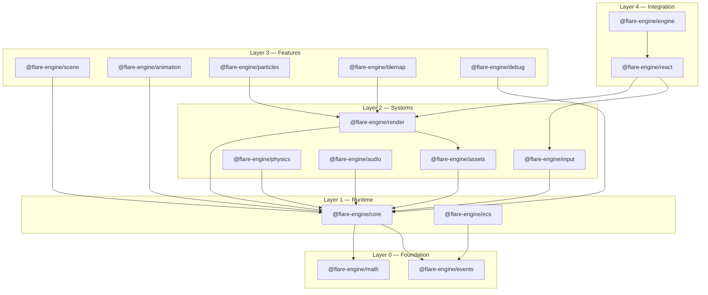

# Flare Engine

> Modular 2D game engine for React Native, built on Skia

**Status:** 🚧 Pre-open-source — packages are under the `@flare-engine/*` scope on npm (not yet published). The repo is private while APIs stabilize; publication will follow once the v0.1 surface freezes.



## Packages

| Package            | Layer | Description                                               |
| ------------------ | ----- | --------------------------------------------------------- |
| `@flare-engine/math`      | 0     | Vec2, Rect, Transform, Color, easings, intersection tests |
| `@flare-engine/events`    | 0     | Type-safe EventEmitter and Signal                         |
| `@flare-engine/core`      | 1     | GameLoop, Clock, AppLifecycle, Pool, Coroutines           |
| `@flare-engine/ecs`       | 1     | Entity-Component-System with archetype queries            |
| `@flare-engine/render`    | 2     | SpriteBatch (Skia Atlas), Camera2D, SpriteEffects         |
| `@flare-engine/input`     | 2     | InputManager, VirtualJoystick, gestures                   |
| `@flare-engine/physics`   | 2     | AABB collision, spatial index, raycasting                 |
| `@flare-engine/audio`     | 2     | AudioManager, SFX pool, music crossfade                   |
| `@flare-engine/assets`    | 2     | Asset loading, sprite sheet parsing                       |
| `@flare-engine/scene`     | 3     | Scene manager, transitions, lifecycle                     |
| `@flare-engine/animation` | 3     | Sprite animation, tweens, springs                         |
| `@flare-engine/particles` | 3     | Particle emitter, pool, immediate-mode Skia               |
| `@flare-engine/tilemap`   | 3     | Tiled/LDtk parser, culled tilemap renderer                |
| `@flare-engine/debug`     | 3     | Dev overlay, stats, entity inspector                      |
| `@flare-engine/react`     | 4     | `<GameView>`, hooks, UI components                        |
| `@flare-engine/engine`    | 4     | Convenience entry point, re-exports                       |

## Getting Started

> **Status:** All 16 packages are implemented and tested — 862 tests, 0 failures.

```bash
bun install
bun run build
bun run test
```

### Quick Example

```tsx
import { createGame } from "@flare-engine/engine";
import { GameView } from "@flare-engine/react";

const game = createGame({
  width: 390,
  height: 844,
  targetFps: 60,
});

export function App() {
  return <GameView game={game} style={{ flex: 1 }} />;
}
```

## Tech Stack

- **Runtime:** Bun
- **Monorepo:** Turborepo
- **Lint + Format:** Biome
- **Build:** tsup (dual CJS/ESM)
- **Test:** Bun test
- **Commits:** Conventional Commits (commitlint)
- **Versioning:** SemVer via Changesets

## License

MIT
