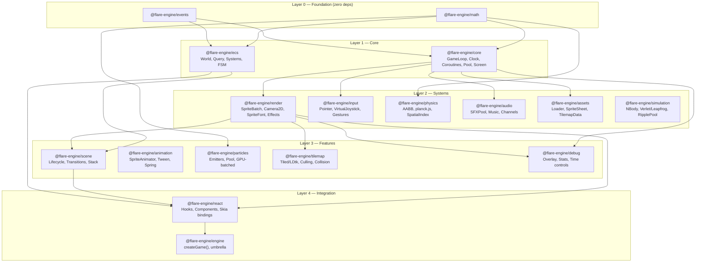

# Flare Engine — Architecture Reference

> Last updated: 2026-04-28

---

## Overview

Flare is a modular, TypeScript-first 2D game engine for React Native + Web, built on `@shopify/react-native-skia` (native) and CanvasKit WASM (web). The architecture is organized into layered packages with strict dependency directions — lower layers never import from higher layers.

The original 16-package core (Layers 0–4) was completed in Phases 1–6. Phase 11 (OSS launch prep) added Layers 2.5 and 3.5 plus tooling and Tier-2 stubs (14 packages + 4 stubs). Post-11.14 extraction work added the `@flare-engine/iap-revenuecat` adapter (concrete RevenueCat `IAPProvider`) and the `@flare-engine/ui-shop` reusable shop UI, bringing the shipping surface to 36 packages. Subsequent additions (`haptics`, `devtools`, `render-web`) and XP6's `@flare-engine/simulation` (n-body, Verlet integrators, wave-packet pool) bring the in-repo total to 40 package dirs (39 scoped `@flare-engine/*` + `create-flare-app`).

---

## Layer Diagram



---

## Module Summary

### Layer 0 — Foundation

| Package                | Purpose                                                                  | Size target | Deps |
| ---------------------- | ------------------------------------------------------------------------ | ----------- | ---- |
| `@flare-engine/math`   | Vec2, Rect, Circle, Transform2D, Mat3, 42 easings, random, intersections | < 5KB       | 0    |
| `@flare-engine/events` | EventEmitter\<EventMap\>, Signal\<T\>                                    | < 1KB       | 0    |

### Layer 1 — Core Runtime

| Package              | Purpose                                                                                        | Size target | Deps         |
| -------------------- | ---------------------------------------------------------------------------------------------- | ----------- | ------------ |
| `@flare-engine/core` | GameLoop (fixed+variable timestep), Clock, AppLifecycle, Coroutines, ObjectPool, ScreenManager | < 3KB       | math, events |
| `@flare-engine/ecs`  | World, Query (archetype bitmask), defineComponent, defineSystem, Prefab, FSM                   | < 8KB       | math, events |

### Layer 2 — System Modules

| Package                 | Purpose                                                                                 | Size target  | Peer deps              |
| ----------------------- | --------------------------------------------------------------------------------------- | ------------ | ---------------------- |
| `@flare-engine/render`  | Skia Atlas SpriteBatch, Camera2D, DrawOrder, SpriteEffects, SpriteFont                  | < 10KB       | react-native-skia      |
| `@flare-engine/input`   | InputManager (polling+events), Pointer, Touch, VirtualJoystick, VirtualButton, Gestures | < 6KB        | gesture-handler        |
| `@flare-engine/physics` | AABB CollisionWorld, SpatialIndex (rbush), planck.js integration, raycast               | < 4KB (AABB) | planck.js optional     |
| `@flare-engine/audio`   | AudioManager, SFXPool, Music, Channels, lifecycle integration                           | < 4KB        | react-native-audio-api |
| `@flare-engine/assets`  | AssetManager, SpriteSheet parser (TexturePacker, Aseprite), loaders, progress           | < 6KB        | —                      |
| `@flare-engine/simulation` | N-body gravity (Plummer softening), velocity-Verlet / leapfrog integrators, wave-packet ripple pool | < 5KB | 0 |

### Layer 3 — Feature Modules

| Package                   | Purpose                                                                                  | Size target |
| ------------------------- | ---------------------------------------------------------------------------------------- | ----------- |
| `@flare-engine/scene`     | Scene lifecycle, SceneManager (stack, transitions: fade/slide)                           | < 4KB       |
| `@flare-engine/animation` | SpriteAnimator (tick-based), Tween (42 easings), Spring, Timeline                        | < 5KB       |
| `@flare-engine/particles` | Emitters, object-pooled, immediate-mode Skia rendering                                   | < 4KB       |
| `@flare-engine/tilemap`   | Tiled .tmj parser, LDtk parser, viewport culling, collision extraction                   | < 8KB       |
| `@flare-engine/debug`     | FPS/entity/draw-call overlay, collision bounds, time controls. Tree-shaken via `__DEV__` | < 3KB       |

### Layer 4 — Integration

| Package                | Purpose                                                                          | Size target |
| ---------------------- | -------------------------------------------------------------------------------- | ----------- |
| `@flare-engine/react`  | `<GameView>`, `useGame()`, `useEntity()`, `<VirtualJoystick>`, `<VirtualButton>` | < 10KB      |
| `@flare-engine/engine` | `createGame()` convenience, re-exports all packages                              | < 2KB       |

---

## Game Loop Order (per frame)

```
1. Clock.tick()         — compute dt, elapsed
2. Input.poll()         — snapshot touch/gesture state
3. onPreUpdate signal
4. Physics.step(fixedDt) — 0-N fixed steps (accumulator pattern)
5. onUpdate(dt)         — ECS systems, game logic
6. onLateUpdate(dt)     — camera follow, post-logic
7. onPreRender signal
8. Render.draw()        — Skia canvas drawing
9. onPostRender signal
```

Physics always runs at fixed rate (default 60Hz). Rendering interpolates between physics states.

---

## Rendering Pipeline (per frame)

```
1. Camera.update()          — compute view matrix
2. Cull entities outside camera.getBounds()
3. Sort by z-index
4. Group by texture atlas (for batching)
5. Per group: SpriteBatch → single Skia <Atlas> draw call
6. Debug overlays (if __DEV__)
```

Two modes:

- **Retained (Atlas)** — fixed entity sprites, transforms via `useRSXformBuffer` worklet on UI thread
- **Immediate (Picture)** — particles, debug, procedural graphics via `PictureRecorder`

---

## Key Design Decisions

| Decision                                                  | Rationale                                        |
| --------------------------------------------------------- | ------------------------------------------------ |
| Vec2 as `{x, y}` objects, not class instances             | Avoids GC pressure in hot loops                  |
| `vec2(x, y)` factory + `Vec2.add(a, b, out?)` static form | Zero-alloc output param for hot paths            |
| Hybrid ECS (object entities + optional SoA typed arrays)  | Good DX for <2K entities, escape hatch for 2K-5K |
| Scene-scoped ECS Worlds                                   | Clean memory on scene switch, no entity leaks    |
| Coroutines via generators                                 | Eliminates callback hell for game sequences      |
| `__DEV__` guards for debug code                           | Tree-shaken in production                        |
| Peer deps for Skia, gesture-handler, planck.js, audio-api | User controls versions; engine stays thin        |

---

## Gap Features (integrated into modules)

| Feature                                | Module        | Priority    | LOC estimate |
| -------------------------------------- | ------------- | ----------- | ------------ |
| Screen scaling (FIT/FILL/STRETCH)      | core          | Must-have   | ~200         |
| Coroutines (generator-based)           | core          | Must-have   | ~150         |
| Object pooling                         | core          | Must-have   | ~80          |
| Spatial partitioning (rbush)           | physics       | Must-have   | ~100         |
| Debug overlay                          | debug (new)   | Should-have | ~300         |
| SpriteEffects (tint, flash, grayscale) | render        | Should-have | ~150         |
| SpriteFont (BMFont)                    | render        | Should-have | ~300         |
| Accessibility hooks                    | core + render | Should-have | ~50          |
| Lightweight FSM                        | ecs           | Should-have | ~100         |

---

## Phase 11 — OSS-launch additions

Phase 11 extends the core 16 packages with the horizontal concerns a full-stack, launchable engine needs. Detailed API contracts in [api-specs.md](api-specs.md); roadmap stages in [../plans/roadmap.md](../plans/roadmap.md).

### Layer 2.5 — Persistence & reliability

| Package                      | Purpose                                                                     |
| ---------------------------- | --------------------------------------------------------------------------- |
| `@flare-engine/storage`      | Typed KV persistence: MMKV (native) / IndexedDB (web) / in-memory adapters  |
| `@flare-engine/errors`       | React error boundary + structured crash payloads + pluggable transport      |
| `@flare-engine/testing`      | Deterministic fake clock, test world, mock input, scene snapshot assertions |
| `@flare-engine/localization` | String tables, ICU plurals, locale resolution                               |
| `@flare-engine/deep-links`   | URL → scene router + history API + `Linking` integration                    |
| `@flare-engine/share`        | `captureScreenshot()` + Web Share API + `expo-sharing` fallback             |
| `@flare-engine/a11y`         | Reduced-motion + contrast tokens (screen-reader coverage in 0.3.0)          |

### Layer 3 — Genre packages

| Package                     | Purpose                                      |
| --------------------------- | -------------------------------------------- |
| `@flare-engine/pathfinding` | A\* grid pathfinding + JPS + flow fields     |
| `@flare-engine/dialogue`    | Branching dialogue graph + runtime evaluator |

### Layer 3.5 — UI & post-processing

| Package                | Purpose                                                                               |
| ---------------------- | ------------------------------------------------------------------------------------- |
| `@flare-engine/ui`     | Themed UI kit (Panel / Button / Label / List / Modal / HUDBar) + focus nav + layout   |
| `@flare-engine/postfx` | Skia RuntimeEffect stack: CRT, bloom, chromatic aberration, vignette, grayscale-flash |

### Tooling

| Package                  | Purpose                                                                                       |
| ------------------------ | --------------------------------------------------------------------------------------------- |
| `@flare-engine/cli`      | `flare pack-atlas`, `flare tiled-to-flare`, `flare new` (sharp + maxrects-packer + commander) |
| `@flare-engine/devtools` | Entity inspector + time scrub + pause/step (0.1.0 partial; full panel in 0.2.0)               |
| `create-flare-app`       | `npm create flare-app@latest` — blank / topdown / shmup templates                             |

### Tier-2 stubs (interface-only at 0.1.0)

`@flare-engine/leaderboards` · `@flare-engine/achievements` · `@flare-engine/iap` · `@flare-engine/analytics` — each exports a typed interface plus a `NoopProvider`. Concrete platform adapters ship as 0.2.0.

---

## Tooling

| Aspect        | Choice                                | Alternative considered  | Why chosen                                                   |
| ------------- | ------------------------------------- | ----------------------- | ------------------------------------------------------------ |
| Runtime + PM  | **Bun**                               | Node + pnpm             | Faster install/test, built-in test runner, TypeScript-native |
| Monorepo      | **Turborepo**                         | Nx, Bun workspaces only | Simple, fast, works with Bun; 36 packages need orchestration |
| Lint + Format | **Biome**                             | ESLint + Prettier       | Single Rust binary, ~100× faster, lint + format in one tool  |
| Commits       | **Conventional Commits** (commitlint) | No enforcement          | Clean changelogs, semantic-versioning automation             |
| Versioning    | **Changesets** (SemVer)               | semantic-release        | Manual control over coordinated multi-package releases       |
| Build         | **tsup**                              | Bun bundler, rollup     | Mature dual CJS+ESM, `.d.ts`. Re-evaluate Bun bundler later. |
| Testing       | **Bun test**                          | Vitest                  | Zero-config, fast, built into runtime. Enough for pure TS.   |
| CI            | **GitHub Actions**                    | —                       | Standard, free for OSS                                       |
| Git hooks     | **Husky** + lint-staged               | simple-git-hooks        | Ecosystem standard, reliable                                 |

### TypeScript configuration

Base (`tsconfig.base.json`) — `strict`, `target: ES2022`, `module: ESNext`, `moduleResolution: bundler`, `verbatimModuleSyntax`, `noUncheckedIndexedAccess`, declaration + sourcemaps on. Each package extends the base and sets its own `outDir: dist`, `rootDir: src`.

### Commit rules

`<type>(<scope>): <description>` — max 72 chars, no emoji in subject. Types: `feat`, `fix`, `perf`, `refactor`, `test`, `docs`, `build`, `ci`, `chore`. Scope is the package name. Breaking: `feat(ecs)!: …` or `BREAKING CHANGE:` in body. Enforced by commitlint via Husky `commit-msg`.

### Turborepo pipeline

```jsonc
{
  "tasks": {
    "build": { "dependsOn": ["^build"], "outputs": ["dist/**"] },
    "test": { "dependsOn": ["build"] },
    "lint": {},
    "typecheck": { "dependsOn": ["^build"] }
  }
}
```

### Changesets

Public npm access, main branch, patch-bump consumers on internal dep change, independent versioning per package, `@changesets/changelog-github` changelog format.
