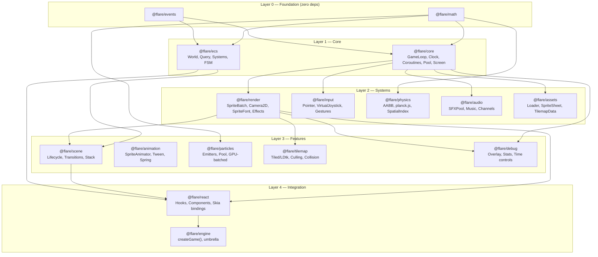

# Flare Engine — Architecture Reference

> Last updated: 2026-04-15

---

## Overview

Flare is a modular, TypeScript-first 2D game engine for React Native, built on `@shopify/react-native-skia`. The architecture is organized into 5 layers (16 packages) with strict dependency directions — lower layers never import from higher layers.

---

## Layer Diagram



---

## Module Summary

### Layer 0 — Foundation

| Package         | Purpose                                                                  | Size target | Deps |
| --------------- | ------------------------------------------------------------------------ | ----------- | ---- |
| `@flare/math`   | Vec2, Rect, Circle, Transform2D, Mat3, 42 easings, random, intersections | < 5KB       | 0    |
| `@flare/events` | EventEmitter\<EventMap\>, Signal\<T\>                                    | < 1KB       | 0    |

### Layer 1 — Core Runtime

| Package       | Purpose                                                                                        | Size target | Deps         |
| ------------- | ---------------------------------------------------------------------------------------------- | ----------- | ------------ |
| `@flare/core` | GameLoop (fixed+variable timestep), Clock, AppLifecycle, Coroutines, ObjectPool, ScreenManager | < 3KB       | math, events |
| `@flare/ecs`  | World, Query (archetype bitmask), defineComponent, defineSystem, Prefab, FSM                   | < 8KB       | math, events |

### Layer 2 — System Modules

| Package          | Purpose                                                                                 | Size target  | Peer deps              |
| ---------------- | --------------------------------------------------------------------------------------- | ------------ | ---------------------- |
| `@flare/render`  | Skia Atlas SpriteBatch, Camera2D, DrawOrder, SpriteEffects, SpriteFont                  | < 10KB       | react-native-skia      |
| `@flare/input`   | InputManager (polling+events), Pointer, Touch, VirtualJoystick, VirtualButton, Gestures | < 6KB        | gesture-handler        |
| `@flare/physics` | AABB CollisionWorld, SpatialIndex (rbush), planck.js integration, raycast               | < 4KB (AABB) | planck.js optional     |
| `@flare/audio`   | AudioManager, SFXPool, Music, Channels, lifecycle integration                           | < 4KB        | react-native-audio-api |
| `@flare/assets`  | AssetManager, SpriteSheet parser (TexturePacker, Aseprite), loaders, progress           | < 6KB        | —                      |

### Layer 3 — Feature Modules

| Package            | Purpose                                                                                  | Size target |
| ------------------ | ---------------------------------------------------------------------------------------- | ----------- |
| `@flare/scene`     | Scene lifecycle, SceneManager (stack, transitions: fade/slide)                           | < 4KB       |
| `@flare/animation` | SpriteAnimator (tick-based), Tween (42 easings), Spring, Timeline                        | < 5KB       |
| `@flare/particles` | Emitters, object-pooled, immediate-mode Skia rendering                                   | < 4KB       |
| `@flare/tilemap`   | Tiled .tmj parser, LDtk parser, viewport culling, collision extraction                   | < 8KB       |
| `@flare/debug`     | FPS/entity/draw-call overlay, collision bounds, time controls. Tree-shaken via `__DEV__` | < 3KB       |

### Layer 4 — Integration

| Package         | Purpose                                                                          | Size target |
| --------------- | -------------------------------------------------------------------------------- | ----------- |
| `@flare/react`  | `<GameView>`, `useGame()`, `useEntity()`, `<VirtualJoystick>`, `<VirtualButton>` | < 10KB      |
| `@flare/engine` | `createGame()` convenience, re-exports all packages                              | < 2KB       |

---

## Game Loop Order (per frame)

```
1. Clock.tick()         — compute dt, elapsed
2. Input.poll()         — snapshot touch/gesture state
3. onPreUpdate signal
4. Physics.step(fixedDt) — 0-N fixed steps (accumulator pattern)
5. onUpdate(dt)         — ECS systems, game logic
6. onLateUpdate(dt)     — camera follow, post-logic
7. onPreRender signal
8. Render.draw()        — Skia canvas drawing
9. onPostRender signal
```

Physics always runs at fixed rate (default 60Hz). Rendering interpolates between physics states.

---

## Rendering Pipeline (per frame)

```
1. Camera.update()          — compute view matrix
2. Cull entities outside camera.getBounds()
3. Sort by z-index
4. Group by texture atlas (for batching)
5. Per group: SpriteBatch → single Skia <Atlas> draw call
6. Debug overlays (if __DEV__)
```

Two modes:

- **Retained (Atlas)** — fixed entity sprites, transforms via `useRSXformBuffer` worklet on UI thread
- **Immediate (Picture)** — particles, debug, procedural graphics via `PictureRecorder`

---

## Key Design Decisions

| Decision                                                  | Rationale                                        |
| --------------------------------------------------------- | ------------------------------------------------ |
| Vec2 as `{x, y}` objects, not class instances             | Avoids GC pressure in hot loops                  |
| `vec2(x, y)` factory + `Vec2.add(a, b, out?)` static form | Zero-alloc output param for hot paths            |
| Hybrid ECS (object entities + optional SoA typed arrays)  | Good DX for <2K entities, escape hatch for 2K-5K |
| Scene-scoped ECS Worlds                                   | Clean memory on scene switch, no entity leaks    |
| Coroutines via generators                                 | Eliminates callback hell for game sequences      |
| `__DEV__` guards for debug code                           | Tree-shaken in production                        |
| Peer deps for Skia, gesture-handler, planck.js, audio-api | User controls versions; engine stays thin        |

---

## Gap Features (integrated into modules)

| Feature                                | Module        | Priority    | LOC estimate |
| -------------------------------------- | ------------- | ----------- | ------------ |
| Screen scaling (FIT/FILL/STRETCH)      | core          | Must-have   | ~200         |
| Coroutines (generator-based)           | core          | Must-have   | ~150         |
| Object pooling                         | core          | Must-have   | ~80          |
| Spatial partitioning (rbush)           | physics       | Must-have   | ~100         |
| Debug overlay                          | debug (new)   | Should-have | ~300         |
| SpriteEffects (tint, flash, grayscale) | render        | Should-have | ~150         |
| SpriteFont (BMFont)                    | render        | Should-have | ~300         |
| Accessibility hooks                    | core + render | Should-have | ~50          |
| Lightweight FSM                        | ecs           | Should-have | ~100         |
