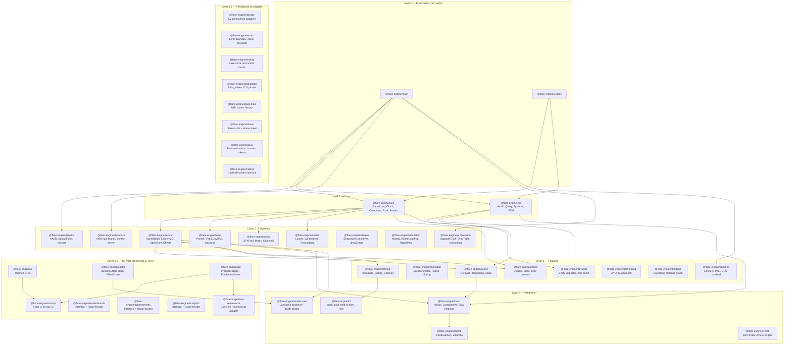

# Flare Engine — Architecture Reference

> Last updated: 2026-09-08

---

## Overview

Flare is a modular, TypeScript-first 2D engine for React Native + Web — animation, gamification, interactive UI, and games — built on `@shopify/react-native-skia` (native) and CanvasKit WASM (web). The architecture is organized into layered packages; the dependency rule is stated once in [AGENTS.md](../../AGENTS.md) and enforced by `scripts/check-deps-tiers.mjs`.

The engine grew in phases — a foundational core (Layers 0–4), then the OSS-launch horizontals (Layers 2.5 and 3.5, tooling, Tier-2 stubs), then extraction work that lifted proven, genre-agnostic game logic back into the engine (`iap-revenuecat`, `ui-shop`, `haptics`, `devtools`, `render-web`, `simulation`, `progression`, `shapes`, `dynamics`). The repository now holds **42 scoped `@flare-engine/*` packages**, the `@flare-engine/create` scaffolder included.

---

## Layer Diagram



Note: the diagram groups packages by their `LAYER_MAP` tier (`scripts/check-deps-tiers.mjs`) but does not draw every dependency edge — only the edges already verified above. Layer 2.5 and the Layer-3.5 Tier-2/adapter packages have no inbound edges shown here for the same reason the pre-2.5 diagram never enumerated every edge.

---

## Module Summary

### Layer 0 — Foundation

| Package                | Purpose                                                                  | Size target | Deps |
| ---------------------- | ------------------------------------------------------------------------ | ----------- | ---- |
| `@flare-engine/math`   | Vec2, Rect, Circle, Transform2D, Mat3, Penner easings, random, intersections | < 5KB       | 0    |
| `@flare-engine/events` | EventEmitter\<EventMap\>, Signal\<T\>                                    | < 1KB       | 0    |

### Layer 1 — Core Runtime

| Package              | Purpose                                                                                        | Size target | Deps         |
| -------------------- | ---------------------------------------------------------------------------------------------- | ----------- | ------------ |
| `@flare-engine/core` | GameLoop (fixed+variable timestep), Clock, AppLifecycle, Coroutines, ObjectPool, ScreenManager | < 3KB       | math, events |
| `@flare-engine/ecs`  | World, Query (archetype bitmask), defineComponent, defineSystem, Prefab, FSM                   | < 8KB       | math, events |

### Layer 2 — System Modules

| Package                 | Purpose                                                                                 | Size target  | Peer deps              |
| ----------------------- | --------------------------------------------------------------------------------------- | ------------ | ---------------------- |
| `@flare-engine/render`  | Skia Atlas SpriteBatch, Camera2D, DrawOrder, SpriteEffects, SpriteFont                  | < 10KB       | react-native-skia      |
| `@flare-engine/input`   | InputManager (polling+events), Pointer, Touch, VirtualJoystick, VirtualButton, Gestures | < 6KB        | gesture-handler        |
| `@flare-engine/physics` | AABB CollisionWorld, SpatialIndex (uniform grid), raycast                                | < 4KB        | —                      |
| `@flare-engine/dynamics` | OBB rigid bodies, SAT + face-clip contact manifolds, sequential-impulse solver          | < 8KB        | math                   |
| `@flare-engine/audio`   | AudioManager, SFXPool, Music, Channels, lifecycle integration                           | < 4KB        | react-native-audio-api |
| `@flare-engine/assets`  | AssetManager, SpriteSheet parser (TexturePacker, Aseprite), loaders, progress           | < 6KB        | —                      |
| `@flare-engine/shapes`  | 12 shape primitives (circle/rect/ngon/star/arc/annulus/trapezoid/…) + `ship` composite + SVG `path` escape hatch; `drawShape` Skia dispatcher, glow rings, ARGB helpers | < 4KB | react-native-skia (type-only) |
| `@flare-engine/simulation` | N-body gravity (Plummer softening), velocity-Verlet / leapfrog integrators, wave-packet ripple pool | < 5KB | 0 |
| `@flare-engine/progression` | Meta-progression primitives: geometric upgrade tracks, pity-aware weighted drop tables, prerequisite unlock DAG, tier resolution, collectible registry | < 5KB | math |

### Layer 3 — Feature Modules

| Package                   | Purpose                                                                                  | Size target |
| ------------------------- | ---------------------------------------------------------------------------------------- | ----------- |
| `@flare-engine/scene`     | Scene lifecycle, SceneManager (stack, transitions: fade/slide)                           | < 4KB       |
| `@flare-engine/animation` | SpriteAnimator (tick-based), Tween (Penner easings) + TweenManager, Spring, step sequences   | < 5KB       |
| `@flare-engine/particles` | Emitters, object-pooled, immediate-mode Skia rendering                                   | < 4KB       |
| `@flare-engine/tilemap`   | Tiled .tmj parser, LDtk parser, viewport culling, collision extraction                   | < 8KB       |
| `@flare-engine/debug`     | FPS/entity/draw-call overlay, collision bounds, time controls. Tree-shaken via `__DEV__` | < 3KB       |

### Layer 4 — Integration

| Package                    | Purpose                                                                          | Size target |
| -------------------------- | -------------------------------------------------------------------------------- | ----------- |
| `@flare-engine/react`      | `<GameView>`, `useGame()`, `useEntity()`, `<VirtualJoystick>`, `<VirtualButton>` | < 10KB      |
| `@flare-engine/render-web` | Web analog of `react`; composes `render` + `postfx` via CanvasKit (`loadCanvasKit`, `createWebSurface`, `createWebSkiaModule`, `createPostFxSurface`) | < 12KB |
| `@flare-engine/engine`     | `createGame()` convenience, curated re-exports (see api-specs § engine)          | < 2KB       |

---

## Game Loop Order (per frame)

```
1. Clock.tick()         — compute dt, elapsed
2. Input.poll()         — snapshot touch/gesture state
3. onPreUpdate signal
4. Physics.step(fixedDt) — 0-N fixed steps (accumulator pattern)
5. onUpdate(dt)         — ECS systems, game logic
6. onLateUpdate(dt)     — camera follow, post-logic
7. onPreRender signal
8. Render.draw()        — Skia canvas drawing
9. onPostRender signal
```

Physics always runs at fixed rate (default 60Hz). Rendering interpolates between physics states.

---

## Rendering Pipeline (per frame)

```
1. Camera.update()          — compute view matrix
2. Cull entities outside camera.getBounds()
3. Sort by z-index
4. Group by texture atlas (for batching)
5. Per group: SpriteBatch → single Skia <Atlas> draw call
6. Debug overlays (if __DEV__)
```

**Runtime model.** The simulation runs on the JS thread, driven by
`requestAnimationFrame` with a fixed-step accumulator, an interpolation `alpha`
and a `maxDt` clamp (default 0.25 s) — `packages/core/src/game-loop.ts`. Every
frame ends by recording an `SkPicture` (`bridge.endFrame()`), and the two targets
then diverge — `packages/react/src/game-view.tsx`:

- **Web** captures on the JS thread, because the web has one thread and the
  capture is same-context by construction. `createSceneCapture(...).capture(pic, …)`
  writes the resulting `SkImage` straight into a shared value.
- **Native** hops the capture to the UI thread: `scheduleOnUI(captureSceneOnUI, …)`
  from `react-native-worklets`. `captureSceneOnUI` is a `'worklet'` that caches an
  offscreen `SkSurface` keyed on pixel size, draws the picture into it, flushes and
  snapshots. This is **ADR-0002** (`docs/design/adr-0002-worklets-migration-and-new-arch-floor.md`),
  which also sets the New Architecture floor and replaced Reanimated's deprecated,
  curried `runOnUI` — `runOnUI(fn)` allocated a wrapper closure every frame inside
  `onPreRender`, the one place this repo forbids allocation.

The scene image lands in a Reanimated `SharedValue<SkImage>` that a Skia `<Image>`
reads directly, so **the per-frame path does not go through React state.** React
state is only touched when the post-FX pass list or the viewport size actually
changes, both guarded against redundant sets.

> **The engine does not use `useRSXformBuffer`, and never has.** Earlier revisions
> of this document said the retained path computed "transforms via `useRSXformBuffer`
> worklet on UI thread". That call does not appear in any of the 41 scoped packages,
> and transforms are computed on the JS thread in `ctx.batch.flush(bridge.drawAtlas, …)`.
> `useRSXformBuffer` is a real *Skia* API — see `ecosystem.md` — but it is a
> capability Flare has not adopted, not a description of this render path.
>
> Corrected 2026-09-08 at HEAD `7f32ad4`. **Worklets themselves are no longer absent:**
> the native capture above is a genuine UI-thread worklet, landed in Arc XR. If this
> paragraph and the code ever disagree again, read `game-loop.ts` and `game-view.tsx`
> — they are the answer, this document is not.

Two draw modes:

- **Retained (Atlas)** — fixed entity sprites, batched into a single `drawAtlas` call
- **Immediate (Picture)** — particles, debug, procedural graphics via `PictureRecorder`

---

## Key Design Decisions

| Decision                                                  | Rationale                                        |
| --------------------------------------------------------- | ------------------------------------------------ |
| Vec2 as `{x, y}` objects, not class instances             | Avoids GC pressure in hot loops                  |
| `vec2(x, y)` factory + `Vec2.add(a, b, out?)` static form | Zero-alloc output param for hot paths            |
| Hybrid ECS (object entities + optional SoA typed arrays)  | Good DX for <2K entities, escape hatch for 2K-5K |
| Scene-scoped ECS Worlds                                   | Clean memory on scene switch, no entity leaks    |
| Coroutines via generators                                 | Eliminates callback hell for game sequences      |
| `__DEV__` guards for debug code                           | Tree-shaken in production                        |
| Peer deps for Skia, Reanimated, audio-api                 | User controls versions; engine stays thin        |
| Simulation on the JS thread; one UI-thread worklet        | See [ADR-0001](adr-0001-renderer-and-threading.md) |

**Architecture Decision Records** live in `docs/design/adr-NNNN-*.md`:

| ADR | Decision | Status |
| --- | --- | --- |
| [0001](adr-0001-renderer-and-threading.md) | Renderer and threading model — JS-thread simulation on `requestAnimationFrame`, a single Reanimated worklet for the scene-texture handoff, no Reanimated animation API | Accepted 2026-09-01 |

---

## Gap Features (integrated into modules)

| Feature                                | Module        | Priority    | LOC estimate |
| -------------------------------------- | ------------- | ----------- | ------------ |
| Screen scaling (FIT/FILL/STRETCH)      | core          | Must-have   | ~200         |
| Coroutines (generator-based)           | core          | Must-have   | ~150         |
| Object pooling                         | core          | Must-have   | ~80          |
| Spatial partitioning (SpatialIndex)    | physics       | Must-have   | ~100         |
| Debug overlay                          | debug (new)   | Should-have | ~300         |
| SpriteEffects (tint, flash, grayscale) | render        | Should-have | ~150         |
| SpriteFont (BMFont)                    | render        | Should-have | ~300         |
| Accessibility hooks                    | core + render | Should-have | ~50          |
| Lightweight FSM                        | ecs           | Should-have | ~100         |

---

## Phase 11 — OSS-launch additions

Phase 11 extends the core 16 packages with the horizontal concerns a full-stack, launchable engine needs. Detailed API contracts in [api-specs.md](api-specs.md); roadmap stages in [../plans/roadmap.md](../plans/roadmap.md).

### Layer 2.5 — Persistence & reliability

| Package                      | Purpose                                                                     |
| ---------------------------- | --------------------------------------------------------------------------- |
| `@flare-engine/storage`      | Typed KV persistence: MMKV (native) / IndexedDB (web) / in-memory adapters  |
| `@flare-engine/errors`       | React error boundary + structured crash payloads + pluggable transport      |
| `@flare-engine/testing`      | Deterministic fake clock, test world, mock input, scene snapshot assertions |
| `@flare-engine/localization` | String tables, ICU plurals, locale resolution                               |
| `@flare-engine/deep-links`   | URL → scene router + history API + `Linking` integration                    |
| `@flare-engine/share`        | `captureScreenshot()` + Web Share API + `expo-sharing` fallback             |
| `@flare-engine/a11y`         | Reduced-motion + contrast tokens (full screen-reader coverage post-launch)  |

### Layer 3 — Genre packages

| Package                     | Purpose                                      |
| --------------------------- | -------------------------------------------- |
| `@flare-engine/pathfinding` | A\* grid pathfinding + JPS + navmesh         |
| `@flare-engine/dialogue`    | Branching dialogue graph + runtime evaluator |

### Layer 3.5 — UI, post-processing & Tier-2

| Package                        | Purpose                                                                               |
| ------------------------------- | ------------------------------------------------------------------------------------- |
| `@flare-engine/ui`             | Themed UI kit (Panel / Button / Label / List / Modal / HUDBar) + focus nav + layout   |
| `@flare-engine/ui-shop`        | Reusable shop UI on `ui` + `iap`: `ShopScreen`, `PaywallModal`, `RestorePurchasesButton` |
| `@flare-engine/postfx`         | Skia RuntimeEffect stack: CRT, bloom, chromatic aberration, vignette, grayscale-flash |
| `@flare-engine/leaderboards`   | Typed interface + `NoopProvider`. Concrete platform adapter (Game Center, Play Games) deferred post-launch. |
| `@flare-engine/achievements`   | Typed interface + `NoopProvider`. Concrete platform adapter deferred post-launch.     |
| `@flare-engine/iap`            | `ProductCatalog` + `EntitlementStore` + content gates, typed interface + `NoopProvider`. |
| `@flare-engine/analytics`      | Typed interface + `NoopProvider`. Concrete platform adapter (PostHog, …) deferred post-launch. |
| `@flare-engine/iap-revenuecat` | Concrete `iap` adapter — RevenueCat, lazy-imported, no-throw `purchase`/`restore` contract. |

### Layer 2.5 — Device feedback

| Package                  | Purpose                                                                                          |
| ------------------------ | ------------------------------------------------------------------------------------------------ |
| `@flare-engine/haptics`  | Typed `HapticsProvider` interface + `NoopHapticsProvider` + React context (`HapticsContext` / `useHaptics`). React peer dep; no bundled native binding. |

### Tooling

`LAYER_MAP` tier per package: `cli` and `create` are 4, `devtools` is 3. The scaffolder was the unscoped, never-published `create-flare-app` until [ADR-0007](adr-0007-scaffolder-is-flare-engine-create.md); it now publishes with the rest of the scope.

| Package                  | Tier | Purpose                                                                                       |
| ------------------------ | ---- | ----------------------------------------------------------------------------------------------- |
| `@flare-engine/cli`      | 4    | `flare pack-atlas`, `flare tiled-to-flare`, `flare new` (sharp + maxrects-packer + commander) |
| `@flare-engine/devtools` | 3    | Entity inspector + time scrub + pause/step (partial slice; full panel post-launch)            |
| `@flare-engine/create`   | 4    | `npm create @flare-engine` — blank / topdown / shmup templates                                |

---

## Post-launch roadmap

Capabilities that appear in older design sketches but are **not shipping** in the launch surface. They are recorded here so the module docs above can stay honest about what exists today.

| Capability | Home package | Status |
| ---------- | ------------ | ------ |
| planck.js rigid-body physics (`PhysicsWorld`, `RigidBody`, `applyForce` / `applyImpulse`) | `physics` (Tier 2) | Not implemented. AABB `CollisionWorld` is the shipping collision model; planck integration is revisited only if AABB proves insufficient. There is no `planck.js` dependency or peer dependency today. |
| ~~Spatial-hash broadphase~~ — **shipped** | `physics` | **Landed 2026-09-03 as CW7-8 (`b617e49`), so this is no longer future work.** `SpatialIndex` is a uniform spatial hash keyed on a packed cell id, and the exported surface was deliberately kept byte-identical, which is why nothing in this table changed at the time. Measured 4.82 ms → 0.18 ms at 1000 sparse bodies. An **rbush**-style tree for very large or heavily-clustered scenes remains unbuilt and unmeasured; treat that, not the grid, as the open item. |
| Flow-field pathfinding | `pathfinding` | A\* + Jump-Point Search + a convex-polygon navmesh ship today; flow fields are not implemented. |

**Positioning notes**

- **Networking is deliberately out of scope.** Flare is a client-side 2D engine; multiplayer transport, netcode, and rollback are non-goals — consumers bring their own networking layer.
- **The API convention is factories returning plain objects.** New public API is factory-shaped (`createX(…)` + free functions over plain-object state, with zero-alloc `out`-param forms on hot paths). The Layer-3-era classes (`ParticleEmitter`, `ErrorBoundary`, and a few others) are grandfathered, not a pattern to extend — the class-vs-factory question is settled in favor of factories, decided before the public API freezes.

---

## Tooling

| Aspect        | Choice                                | Alternative considered  | Why chosen                                                   |
| ------------- | ------------------------------------- | ----------------------- | ------------------------------------------------------------ |
| Runtime + PM  | **Bun**                               | Node + pnpm             | Faster install/test, built-in test runner, TypeScript-native |
| Monorepo      | **Turborepo**                         | Nx, Bun workspaces only | Simple, fast, works with Bun; 42 packages need orchestration |
| Lint + Format | **Biome**                             | ESLint + Prettier       | Single Rust binary, ~100× faster, lint + format in one tool  |
| Commits       | **Conventional Commits** (commitlint) | No enforcement          | Clean changelogs, semantic-versioning automation             |
| Versioning    | **Changesets** (SemVer)               | semantic-release        | Manual control over coordinated multi-package releases       |
| Build         | **tsdown**                            | tsup, Bun bundler       | Rolldown-based; dual CJS+ESM + `.d.ts`. Replaced tsup in the C4 toolchain migration. |
| Testing       | **Bun test**                          | Vitest                  | Zero-config, fast, built into runtime. Enough for pure TS.   |
| CI            | **GitHub Actions**                    | —                       | Standard, free for OSS                                       |
| Git hooks     | **Husky** + lint-staged               | simple-git-hooks        | Ecosystem standard, reliable                                 |

### TypeScript configuration

Base (`tsconfig.base.json`) — `strict`, `target: ES2022`, `module: ESNext`, `moduleResolution: bundler`, `verbatimModuleSyntax`, `noUncheckedIndexedAccess`, declaration + sourcemaps on. Each package extends the base and sets its own `outDir: dist`, `rootDir: src`.

### Commit rules

`<type>(<scope>): <description>` — max 72 chars, no emoji in subject. Types: `feat`, `fix`, `perf`, `refactor`, `test`, `docs`, `build`, `ci`, `chore`. Scope is the package name. Breaking: `feat(ecs)!: …` or `BREAKING CHANGE:` in body. Enforced by commitlint via Husky `commit-msg`.

### Turborepo pipeline

```jsonc
{
  "tasks": {
    "build": { "dependsOn": ["^build"], "outputs": ["dist/**"] },
    "test": { "dependsOn": ["build"] },
    "lint": {},
    "typecheck": { "dependsOn": ["^build"] }
  }
}
```

### Changesets

**Restricted** npm access (public at the October 2026 flip), main branch, patch-bump consumers on internal dep change, **lockstep (`fixed`) versioning** across every `@flare-engine/*` package — never a single-package bump — and the built-in `@changesets/cli/changelog` format.
