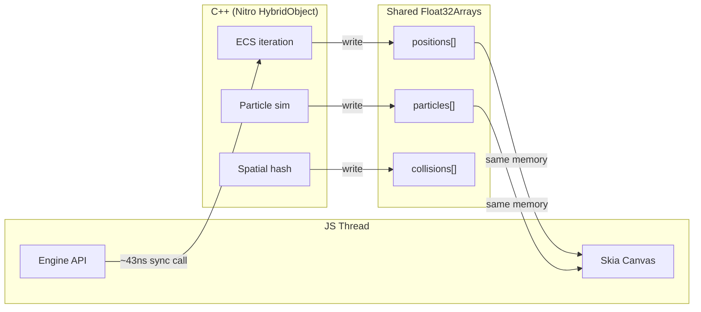

# Flare Engine — Native C++ Acceleration Strategy

> Last updated: 2026-04-20

---

## Strategy: JS First, C++ Second

**Phases 1–9 (done):** Everything in TypeScript. Ship working modules. Validate APIs on device (`apps/demo` full loop verified pre-retirement; [Pan Tvardowski](https://github.com/grzott/Pan-Tvardowski) — now in its own repo — is the canonical reference).
**Phase 8 (in progress):** Microbenches shipped; device FPS capture pipeline ready and pending hardware run.
**Phase 10 (data-gated):** Once device numbers land, move the measured bottlenecks to C++ via Nitro Modules.

Why not C++ from day 1? API design iterates much faster in TS. Once the API is stable and bottlenecks are _measured_ (not guessed), targeted C++ drops give the biggest wins with least complexity.

---

## Nitro Modules (by Margelo)

| Metric        | Value                            |
| ------------- | -------------------------------- |
| Stars         | 1,800                            |
| npm DL/week   | 763,736                          |
| Version       | 0.35.4                           |
| License       | MIT                              |
| Call overhead | **~43ns/call** (C++, iPhone Air) |

### How It Works

Nitro exposes C++ objects to JS as first-class JSI objects with synchronous methods. No bridge, no serialization.

Key capability: **Zero-copy Float32Array sharing**. JS creates a `Float32Array` backed by `ArrayBuffer` → C++ gets raw `float*` pointer via `std::shared_ptr<ArrayBuffer>` → writes data → JS Skia reads same memory for rendering. Zero copies, zero serialization.

### Call Budget at 60fps

Frame budget: 16.67ms = 16,670,000ns

| Module type      | Per-call overhead | Calls per frame budget |
| ---------------- | ----------------- | ---------------------- |
| Nitro C++        | ~43ns             | ~387,000               |
| TurboModules C++ | ~140ns            | ~119,000               |
| Expo Modules     | ~4,349ns          | ~3,800                 |

The JSI boundary is NOT the bottleneck for game workloads.

---

## JS vs C++ Performance on Hermes

Hermes is an interpreter — no JIT on mobile. For compute-bound game loops, C++ is 10-100x faster:

| Operation                          | Hermes     | C++ (ARM NEON) | Speedup |
| ---------------------------------- | ---------- | -------------- | ------- |
| 5000 entity position updates       | ~1-4ms     | ~0.05-0.1ms    | 10-30x  |
| 500 particle updates               | ~0.5-1.5ms | ~0.02-0.05ms   | 20-100x |
| Spatial hash query (1000 entities) | ~1-3ms     | ~0.03-0.1ms    | 15-50x  |
| Box2D 100 bodies                   | ~3-10ms    | ~0.1-0.3ms     | 30-100x |

---

## Zero-Copy Architecture



---

## C++ Subsystem Priority

| #   | Subsystem                | Speedup | Effort             | When                               |
| --- | ------------------------ | ------- | ------------------ | ---------------------------------- |
| P0  | Particle simulation      | 20-100x | Low (~50 LOC C++)  | Phase 10                           |
| P0  | ECS hot loop iteration   | 10-30x  | Medium             | Phase 10                           |
| P1  | Spatial hash grid        | 15-50x  | Low-Med (~200 LOC) | Phase 10                           |
| P1  | Physics (wrap Box2D C++) | 30-100x | High (~1000 LOC)   | Phase 10+                          |
| P2  | Pathfinding (A\*/JPS)    | 20-50x  | Medium             | On demand (pure-JS shipped in 0.1) |
| P2  | Collision narrowphase    | 10-30x  | Medium             | Phase 10+                          |
| P3  | Transform hierarchy      | 10-25x  | Medium             | Only if >500 hierarchical entities |

---

## Background Thread Game Logic (Bonus)

`react-native-worklets-core` (780 stars, 115K DL/week) can create JS runtimes on arbitrary named threads:

```ts
const gameThread = Worklets.createContext("game-logic");
```

Combined with Nitro C++ and shared Float32Arrays: true multi-threaded game architecture. ECS on background thread, Skia renders on UI thread, zero-copy data sharing. No other TS game engine offers this.

---

## Proven Precedents

| Library               | Stars | What it proves                                                                   |
| --------------------- | ----- | -------------------------------------------------------------------------------- |
| react-native-filament | 1,300 | Full 3D engine (Filament) + Bullet3 physics in C++, React API. 90.9% C++.        |
| react-native-mmkv v4  | 8,300 | Rewritten as Nitro Module. Synchronous C++ calls, ~30x faster than AsyncStorage. |
| VisionCamera          | ~7K   | Real-time 60fps frame processing via worklets + C++.                             |
