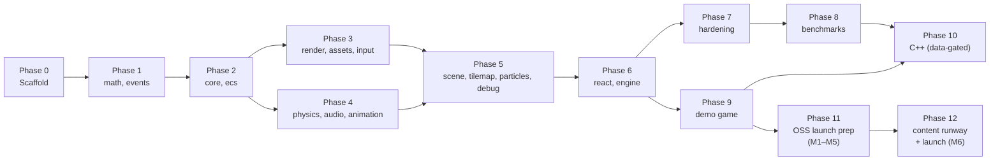

# Flare Engine — Build Plan Overview

> Engine: **Flare** — modular 2D game engine for React Native + Web on Skia
> Package scope: `@flare-engine/*` on npm (org reserved 2026-04-17); unscoped metapackage `flare-engine` (optional)
> Monorepo: Bun + Turborepo + Biome
> **OSS launch target: October 2026** (6-month runway from 2026-04-17)

---

## Phase Summary

| Phase                 | Packages                                 | Depends on | Status                 | Milestone                                                                                                                                                                                                                    |
| --------------------- | ---------------------------------------- | ---------- | ---------------------- | ---------------------------------------------------------------------------------------------------------------------------------------------------------------------------------------------------------------------------- |
| 0 — Repo scaffold     | —                                        | —          | ✅ DONE                | `bun install` works, `turbo build` runs, hooks enforce commits                                                                                                                                                               |
| 1 — Foundation        | `math`, `events`                         | —          | ✅ DONE                | All math/event primitives, full test coverage                                                                                                                                                                                |
| 2 — Core Runtime      | `core`, `ecs`                            | Phase 1    | ✅ DONE                | GameLoop, ECS, coroutines, pooling working                                                                                                                                                                                   |
| 3 — Rendering + Input | `render`, `assets`, `input`              | Phase 2    | ✅ DONE                | 100+ sprites at 60fps on device                                                                                                                                                                                              |
| 4 — Systems           | `physics`, `audio`, `animation`          | Phase 2    | ✅ DONE                | Collisions, audio, tweens working                                                                                                                                                                                            |
| 5 — Features          | `scene`, `tilemap`, `particles`, `debug` | Phase 3+4  | ✅ DONE                | Tiled maps, particles, scenes, dev overlay                                                                                                                                                                                   |
| 6 — Integration       | `react`, `engine`                        | Phase 5    | ✅ DONE                | Full example game on iOS + Android                                                                                                                                                                                           |
| 7 — Hardening         | —                                        | Phase 6    | ✅ DONE (pass 1)       | Audit, optimize, fix gaps, stress-test all APIs                                                                                                                                                                              |
| 8 — Benchmarking      | `benchmarks/` + `apps/bench-dashboard/`  | Phase 7    | ✅ DONE                | Microbench + integration bench + dashboard done; Android device capture recorded (Galaxy A54 5G release); Phase 10 gating decision written; iOS capture optional follow-up                                                   |
| 9 — Demo Game         | `apps/demo` (retired 2026-04-24)          | Phase 6    | ✅ DONE (retired)      | `apps/demo` shipped as proof-of-concept + integration smoke test (menu + save slots → base hub → dialogue → play → end summary; MMKV-persisted; PolyForm-NC). Retired at stage 11.14 once `apps/pan-tvardowski` main menu (M9.1) shipped. PT free zones 1–3 are now the canonical end-to-end reference.          |
| 10 — C++ Acceleration | `native`                                 | Phase 8+9  | ⬜ data-gated          | C++ via Nitro only where benchmarks show need (particles first)                                                                                                                                                              |
| 11 — OSS Launch Prep  | 14 new packages + 4 stubs + web parity   | Phase 6    | 🟡 in progress (M1–M5) | Full-stack RN+Web engine, landing-page MP4 (live web build dropped 2026-04-22), docs site, Pan Tvardowski showcase game ([plan](./pan-tvardowski-build-plan.md)). Game 2 (roguelike) deferred post-launch (private dogfood). |
| 12 — Launch + Content | —                                        | Phase 11   | ⬜ planned (M6)        | Pre-launch content runway (7 posts) + coordinated OSS drop                                                                                                                                                                   |

---

## Phase Details

### Phases 0–9 — archived

All ✅ **DONE** (completed 2026-04-16). Full details preserved verbatim in [docs/history/build-plan-archive.md](../history/build-plan-archive.md). Package-level status lives in [builder-reference.md](../references/builder-reference.md).

Summary of what shipped:

- **P0–P6 — engine core** (16 packages across foundation → core → rendering/input → systems → features → integration). All green on device.
- **P7 — hardening** (2 passes): API audit, zero-alloc pass on hot paths (`CollisionWorld.step`, `RenderSystem`, `Camera2D`, `ParticlePool`, `TilemapRenderer`), integration bench + heap-delta check.
- **P8 — benchmarking**: microbenches + integration bench shipped; Android device capture (Samsung Galaxy A54 5G, release build) recorded in [`benchmarks/results/device.json`](../../benchmarks/results/device.json). Gating decision: Phase 10 stays deferred; physics broadphase would be the first C++ target if ever needed. iOS capture + audio/GC device measurements are optional follow-ups.
- **P9 — demo game**: `apps/demo` shmup shipped, playable end-to-end on device. Kenney atlas swap dropped 2026-04-22. Retired at stage 11.14 once PT M9.1 main menu shipped — `apps/pan-tvardowski` free zones 1–3 are now the canonical end-to-end reference.

### Phase 10 — C++ Acceleration (data-gated)

- Only start after Phase 8 benchmarks identify actual bottlenecks
- Priority order (per `docs/design/native-acceleration.md`):
  1. Particle simulation (highest speedup, lowest effort — ~50 LOC C++)
  2. ECS hot loop iteration
  3. Spatial hash grid
  4. Physics (Box2D C++ — only if planck.js is measured bottleneck)
- Nitro Modules + zero-copy Float32Array architecture
- Background thread game logic via `react-native-worklets-core` (optional)

- Nitro Modules + zero-copy Float32Array architecture
- Background thread game logic via `react-native-worklets-core` (optional)

### Phase 11 — OSS Launch Prep (M1–M5, 5 months)

#### 11.0 Context & constraints

**Positioning.** Full-stack end-to-end 2D game engine for **React Native + Web**. Not competing with Unity / Godot / Defold. Competing with the fact there is no proper option in the RN ecosystem today. One codebase → iOS + Android + browser.

**Competitive landscape (snapshot 2026-04-17).**

- `react-native-game-engine` (bberak) — 3.1k ★, 11.8k weekly DLs, ~2 yrs quiet. Legacy incumbent by inertia; frustrated users = Flare's launch audience.
- `rn-game-engine-next` (ahsanmunyr) — published 2026-04-08, v0.2.0, 63 weekly DLs, 0 issues / PRs. Skia-renderer + Arcade/Matter + scenes/haptics/sensors, but still RNGE paradigm (setState-per-frame or SharedValue writes, POJOs, immutable spread). No atlas batching, ECS archetypes, particles, tilemap, animation, audio, zero-alloc hot paths, web support. Low-medium threat; different architecture tier.
- Other RN-Skia game repos are demo-scale (≤7 ★).
- **Moats that can't close in 6 months:** web parity (cross-cutting across `render`/`audio`/`input`/`assets`), archetype ECS + zero-alloc, GPU atlas batching, the 16 already-shipped packages, device-verified full loop.
- **Anti-copyist rule:** pre-launch content is **technique posts**, not **architecture posts**. Don't hand a blueprint to a race-to-launch.

**Package audit — what "full-stack" requires beyond the existing 16.**

Tier 1 — shipping at 0.1.0 (14):

- `@flare-engine/storage` ★ — MMKV native + IndexedDB web, typed schema, migrations, save slots, import/export
- `@flare-engine/ui` ★ — Skia-rendered UI kit: Panel / Button / Label / List / Modal / HUDBar / ProgressBar, focus nav (keyboard + gamepad), theme tokens, flex-like layout
- `@flare-engine/input` gamepad + remap ★ — Web Gamepad API + native, unified behind `InputManager`
- `@flare-engine/postfx` ★ — Skia RuntimeEffect stack: CRT / bloom / chromatic aberration / vignette / grayscale-flash
- `@flare-engine/cli` ★ — `flare pack-atlas`, `flare tiled-to-flare`, `flare new`
- `create-flare-app` ★ — `npm create flare-app@latest`, Expo + Flare starter
- Web parity inside existing packages ★ — CanvasKit in `render`, Web Audio in `audio`, pointer events in `input`, fetch loader in `assets`
- `@flare-engine/errors` ★ — error boundary + structured crash payload, pluggable Sentry / no-op default
- `@flare-engine/localization` — string tables + ICU plurals
- `@flare-engine/deep-links` — URL → scene router + web history API
- `@flare-engine/testing` — deterministic `World` factory, mock `InputManager`, scene snapshot assertions
- `@flare-engine/devtools` (partial) — entity inspector + time scrub + pause/step (full inspector 0.2.0)
- `@flare-engine/share` — screenshot + Web Share API + `expo-sharing`
- `@flare-engine/a11y` (light) — reduced-motion + contrast tokens for `@flare-engine/ui` (screen-reader 0.3.0)

Tier 2 — interface stubs at 0.1.0, adapters later (4): `@flare-engine/leaderboards`, `@flare-engine/achievements`, `@flare-engine/iap`, `@flare-engine/analytics`. Stubs unblock consumers; adapters ship as 0.2.0.

Tier 3 — public roadmap (10): `cloud-save`, `push`, OTA guide (doc only), `ai` (BT + Utility AI), `pathfinding`, `lighting`, `dialogue`, `cinematics`, `net`, `replay`.

Genre-enabling pulled forward (Game 2 demand): `pathfinding` (roguelike needs it, ship stage 11.6), `dialogue` (JRPG needs it, ship stage 11.6).

**Game 2 — deferred post-launch (2026-04-20 decision).** The roguelike + JRPG battle app is moved out of the OSS launch scope and will live in a **separate private repo** as the author's own game. It becomes the real-world post-launch dogfood test of the published 0.1.0 engine — the "living-organism" test. Consequence: `@flare-engine/pathfinding` and `@flare-engine/dialogue` ship at 0.1.0 without a shipped-in-repo consumer (risk flagged in stage 11.7). Genre-package validation relies on their own test suites + the post-launch private-repo dogfood. `apps/roguelike/` is NOT created in this repo.

**Scope drop order** if falling behind mid-phase: `share` → `devtools` partial → `a11y` light → `localization` → `deep-links`. `ui` + `storage` + web parity are non-negotiable.

**Stage map.**

| Stage | Calendar      | Goal                                       | Deliverable                                                                                                 |
| ----- | ------------- | ------------------------------------------ | ----------------------------------------------------------------------------------------------------------- |
| 11.1  | M1 W1         | npm + infra + web spike                    | scope reserved, CanvasKit parity report, `@flare-engine/storage` 0.1                                        |
| 11.2  | M1 W2         | reliability substrate                      | `@flare-engine/errors`, `@flare-engine/testing`, web parity in existing packages                            |
| 11.3  | M1 W3–W4      | UI kit                                     | `@flare-engine/ui` 0.1, demo menus ported                                                                   |
| 11.4  | M2 W1–W2      | input + postfx                             | `@flare-engine/input` gamepad + remap, `@flare-engine/postfx` 0.1                                           |
| 11.5  | M2 W3         | i18n + share + a11y                        | `@flare-engine/localization`, `@flare-engine/deep-links`, `@flare-engine/share`, `@flare-engine/a11y` light |
| 11.6  | M2 W4         | Game 2 scaffold + atlas swap               | `apps/roguelike` skeleton, Kenney atlas in demo                                                             |
| 11.7  | M3 W1–W2      | Game 2 vertical slice + genre packages     | `@flare-engine/pathfinding`, `@flare-engine/dialogue`, roguelike procgen + battle loop                      |
| 11.8  | M3 W3–W4      | CLI + scaffolder                           | `@flare-engine/cli`, `create-flare-app`                                                                     |
| 11.9  | M4 W1–W2      | Game 2 content                             | enemy roster, boss, meta-progression, save/load                                                             |
| 11.10 | M4 W3–W4      | devtools + Tier-2 stubs                    | `@flare-engine/devtools` partial, 4 adapter stubs                                                           |
| 11.11 | M5 W1–W2      | web builds                                 | both demos on staging GH Pages, perf locked                                                                 |
| 11.12 | M5 W3         | docs site                                  | `apps/site` Docusaurus, guides, API ref                                                                     |
| 11.13 | M5 W4         | API lock + RC                              | snapshot tests, device bench, RC to npm                                                                     |
| 11.14 | parallel M9.x | Extraction + reusability + demo retirement | Extract PT's genre-agnostic patterns back into engine; retire `apps/demo` (✅ closed 2026-04-24)      |

**Store lineup (engine promotion, post-0.1.0).** The engine's launch is anchored by **three planned games** built on it: **Pan Tvardowski** (shmup, PT = the 0.1.0 anchor), a top-down action-adventure, and a deck-builder. Only PT is planned in this repo; the other two are noted here so readers understand the reusability intent driving stage 11.14's genre-agnostic rule. Details of the other two games are out of scope until PT ships.

---

#### 11.0.1 OSS-readiness pre-work (complete before 11.13 RC)

Concrete, small, unblocks the launch-week flip. Land alongside the stages they touch; don't bundle into 12.5.

1. **LICENSE propagation.** ✅ DONE — `scripts/propagate-license.ts` wired via root `prebuild` + `release` npm scripts; `LICENSE` is copied into every `packages/*/` before `tsup` runs.
2. **Per-package README stubs.** 1-paragraph `README.md` in each `packages/*/` — name, one-line description, install snippet, link to docs site. Prevents empty npm landing pages at 0.1.0. Land at stage 11.12 alongside the docs site.
3. **Governance + safety files.** `CODE_OF_CONDUCT.md` (Contributor Covenant 2.1), `SECURITY.md` (email disclosure + 90-day policy), `CODEOWNERS` (auto-assign self), `.github/ISSUE_TEMPLATE/` (bug, feature, question), `.github/PULL_REQUEST_TEMPLATE.md`. Land at stage 11.13 so the RC dry-run exercises them, not launch day.
4. **API-snapshot tooling.** Pick **`@arethetypeswrong/cli`** (types publish-correctness) + a hand-rolled `*.d.ts` textual snapshot per package (tiny, no new heavy dep). Skip `@microsoft/api-extractor` — too heavy for 16 packages. Land at stage 11.13.
5. **npm publish auth.** Switch `release.yml` to **npm OIDC Trusted Publishers** (configured in npm settings → Publishing Access) and drop the `NPM_TOKEN` secret. Requires npm 2FA on the account. Land at stage 11.13 before RC cut.
6. **Build-plan archival.** At stage 11.13 after API lock, move Phases 0–9 to `docs/history/build-plan-archive.md`; keep `docs/plans/build-plan.md` forward-only. Shrinks agent token drain ~15 KB.

#### 11.1 — npm + infra + web spike (M1 W1)

- **Goal.** Close out npm scope work, prove or disprove CanvasKit atlas parity before committing 5 months of work, ship the first persistence primitive.
- **Tasks.**
  1. npm scope: `@flare-engine` org created 2026-04-17. Flip publishable `packages/*` `"private": true` → `false` only at stage 11.13 RC cut; keep apps + benchmarks private forever.
  2. `LICENSE` propagation step from 11.0.1 (1).
  3. 2-day CanvasKit spike in a throwaway branch: atlas draw, tint, bitmap font, blend modes. Fill in the "Spike Results" table of [canvaskit-parity.md](../references/canvaskit-parity.md) (the functional/API audit is already done — CanvasKit-WASM v0.41.1 has every API Flare uses; the spike confirms WebGL perf).
  4. Implement `@flare-engine/storage`: MMKV adapter (native) + IndexedDB adapter (web), typed schema with Zod-ish validator, migration runner, save slots, JSON import/export.
- **Done when.** Parity report is committed; `@flare-engine/storage` 0.1 passes `typecheck && lint && test && build` on both platforms; every tarball built by `bun run build` contains `LICENSE`.
- **Status (2026-04-20).** ✅ Parity report landed at [docs/references/canvaskit-parity.md](../references/canvaskit-parity.md) — no API blockers, `full` CanvasKit bundle recommended. Storage shipped. LICENSE propagation wired. Perf spike (Day 2) superseded by MP4-fallback decision taken upfront in stage 11.11.
- **Exit criteria / contingency.** If CanvasKit atlas batching is broken → commit to per-sprite web path in stage 11.11 and budget extra 3 days in M5; no change to calendar.

#### 11.2 — Reliability substrate (M1 W2)

- **Goal.** Every downstream package can rely on a uniform error/crash story and a deterministic test substrate.
- **Tasks.**
  1. `@flare-engine/errors`: React error boundary, structured crash payload (serializable), pluggable transport (Sentry adapter optional, no-op default).
  2. `@flare-engine/testing`: deterministic `World` factory with injectable Clock, mock `InputManager`, scene snapshot assertions, fake frame clock.
  3. Web parity fixes in `@flare-engine/render` (CanvasKit image loader), `@flare-engine/audio` (Web Audio backend), `@flare-engine/input` (pointer + keyboard), `@flare-engine/assets` (fetch loader). No API changes — backend switch behind existing exports.
- **Done when.** `bun --cwd apps/pan-tvardowski run web` boots to the menu with no platform-specific code in the game; `@flare-engine/testing` used in at least one new test in `@flare-engine/core`.

#### 11.3 — UI kit (M1 W3–W4)

- **Goal.** Every downstream demo + Game 2 + Game 1 renders HUD and menus through one consistent kit.
- **Tasks.**
  1. `@flare-engine/ui` primitives: `Panel`, `Button`, `Label`, `List`, `Modal`, `HUDBar`, `ProgressBar`.
  2. Focus navigation: keyboard + gamepad (stage 11.4 feeds this), tab order, focus ring.
  3. Theme tokens (color, spacing, type scale) + flex-like layout resolver.
  4. Port the in-repo game's menus (main, pause, game-over, victory) and HUD to `@flare-engine/ui`; delete ad-hoc RN views.
- **Done when.** Demo menus and HUD are `@flare-engine/ui`-only; keyboard tab navigates the menu; snapshot tests cover each primitive.

#### 11.4 — Input (gamepad + remap) + PostFX (M2 W1–W2)

- **Goal.** First-class gamepad + the visual-polish knob new users evaluate on first contact.
- **Tasks.**
  1. `@flare-engine/input` gamepad: Web Gamepad API + native `react-native-gamepad` (or equivalent); unified `InputManager.gamepad(id)` surface; dead zones; button/axis remap table persisted via `@flare-engine/storage`.
  2. `@flare-engine/postfx` Skia RuntimeEffect stack: CRT, bloom, chromatic aberration, vignette, grayscale-flash. Composable via an ordered effect chain on the scene's render target.
  3. Wire 3 effects into demo (vignette always-on, grayscale-flash on hit, CRT in a settings toggle).
- **Done when.** Gamepad drives demo menu + gameplay; postfx toggle in settings menu shows visible effect; shader fallback path documented for devices without RuntimeEffect support.

#### 11.5 — Localization + deep-links + share + a11y light (M2 W3)

- **Goal.** Clear the remaining horizontal concerns so M2 W4 onward is Game 2 focus.
- **Tasks.**
  1. `@flare-engine/localization`: string tables, locale resolution, ICU-style plurals + interpolation, hot-reload in dev.
  2. `@flare-engine/deep-links`: URL → scene + params router, history API on web, `Linking` on native.
  3. `@flare-engine/share`: `captureScreenshot()` (Skia `makeImageSnapshot`), Web Share API + `expo-sharing` fallback.
  4. `@flare-engine/a11y` (light): reduced-motion flag wired into `@flare-engine/animation` + `@flare-engine/postfx`, contrast tokens in `@flare-engine/ui`. Full screen-reader pass deferred to 0.3.0.
- **Done when.** Demo has a working language switcher, a deep link that opens the bench scene, a share-screenshot button, and a reduced-motion setting that neutralizes screen shake + heavy postfx.

#### 11.6 — ❌ DROPPED (2026-04-20)

Roguelike scaffold moved to post-launch private repo. Kenney atlas swap dropped entirely (the original `apps/demo` target was retired at stage 11.14); PT uses a shape-atlas visual style instead of sprite art.

#### 11.7 — Genre packages (revised 2026-04-20)

- **Goal.** Ship `@flare-engine/pathfinding` + `@flare-engine/dialogue` as standalone 0.1.0 packages. In-repo consumer validation (roguelike) deferred post-launch.
- **Status.** ✅ Both packages shipped with their own test suites (pathfinding 54 tests, dialogue 41 tests). Pathfinding microbench added in `benchmarks/`.
- **Known risk.** No in-repo game consumes these end-to-end before 0.1.0. The author's post-launch private roguelike is the designated real-world test; bugs discovered there will feed 0.1.x patches.

#### 11.8 — CLI + scaffolder (M3 W3–W4)

- **Goal.** First-time users hit a working app in <5 minutes.
- **Tasks.**
  1. `@flare-engine/cli` commands: `flare pack-atlas <input>` (TexturePacker-compatible JSON + PNG, uses `maxrects-packer` for bin-packing + `sharp` for image I/O per [cli-image-tooling.md](../references/cli-image-tooling.md)), `flare tiled-to-flare <tmj>` (normalized runtime JSON), `flare new <name>` (alias for create-flare-app).
  2. `create-flare-app` scaffolder: Expo + Flare + minimal scene + HUD; selectable template (`blank`, `topdown`, `shmup`).
  3. CI for both on GitHub Actions; publish both under `next` dist-tag for internal testing.
- **Done when.** On a clean machine, `npm create flare-app@latest test-game && cd test-game && bun install && bun run dev` produces a running app in <5 min.

#### 11.9 — ❌ DROPPED (2026-04-20)

Game 2 content moved to post-launch private repo. No impact on OSS 0.1.0 — launch-week demo content comes from `apps/pan-tvardowski` (device video + store-page links).

#### 11.10 — Devtools + Tier-2 stubs (M4 W3–W4)

- **Goal.** Land the devtools slice that makes a screencast and the adapter surfaces that unblock 3rd-party integrations.
- **Tasks.**
  1. `@flare-engine/devtools` partial: entity inspector (tap → panel), time scrub (rewind N frames from ring buffer), pause/step; web-only full panel, native-only HUD.
  2. Interface stubs (types + no-op adapter + docs, no concrete provider): `@flare-engine/leaderboards`, `@flare-engine/achievements`, `@flare-engine/iap`, `@flare-engine/analytics`. Each exports the interface + a default `NoopProvider` + README with a table of planned providers for 0.2.0.
- **Done when.** Devtools demo GIF recorded; stubs typecheck and import cleanly from a consumer that mounts the no-op providers.

#### 11.11 — Landing-page demo (revised 2026-04-22)

- **Goal.** Landing page has a visible gameplay surface + a path from docs to a published store page, proving the engine ships end-to-end games.
- **Decision (2026-04-22).** Live web build dropped entirely for 0.1.0. Engine-side CanvasKit parity is already proven (see [canvaskit-parity.md](../references/canvaskit-parity.md)); a live web demo adds hosting and perf-tuning surface with no launch-week payoff. The showcase game **Pan Tvardowski** ([docs/plans/pan-tvardowski-build-plan.md](./pan-tvardowski-build-plan.md)) supplies both the landing-page MP4 and the store-page link; `apps/demo` was retired at stage 11.14 once PT M9.1 shipped.
- **Tasks.**
  1. Placeholder MP4 slot in `apps/site` — an empty `<video>` element with a swappable URL. User drops in the final file when Pan Tvardowski gameplay is recordable.
  2. Record the placeholder MP4 from `apps/pan-tvardowski` (device build, menu → play → boss) so the site never ships with a broken embed; replace with the final PT gameplay reel before RC.
  3. Docs-site store-page links (per [pan-tvardowski-build-plan.md §18](./pan-tvardowski-build-plan.md#18--publishing-plan)): Google Play + App Store first; Steam as 0.2.0 stretch.
- **Done when.** MP4 + poster placeholders live on the Docusaurus site; store-page links exist (even if listed as "coming soon" at RC cut).
- **Dropped.** Expo web export, CanvasKit live bundle tuning, Tauri wrap. All moved to post-0.1.0.

#### 11.12 — Docs site (M5 W3, revised 2026-04-20)

- **Goal.** First-time visitor → running code in 10 minutes; power-user → API reference for every symbol.
- **Scope change.** Deferred to pre-launch polish — treated as a bundled deliverable with stage 11.13 so it ships on fresh 0.1.0 package surface (no rework from post-RC API changes).
- **Tasks.**
  1. `apps/site` Docusaurus on GH Pages; custom landing page embedding the demo MP4 (+ optional live iframe).
  2. Getting Started (10-min tutorial): install, first scene, first entity, first input.
  3. 14 per-package guides (~500–1000 words each): concepts, key APIs, worked example, gotchas.
  4. typedoc API reference auto-generated in CI.
  5. Architecture doc + design-rationale doc lifted from `docs/design/`.
- **Done when.** `bun --cwd apps/site run build` ships on GH Pages staging; Lighthouse ≥90 on perf + a11y + SEO.

#### 11.13 — API lock + device bench + RC + pre-launch polish (M5 W4)

- **Goal.** Freeze the public surface; publish a release candidate under the reserved scope. Land every pre-launch polish item that was deferred.
- **Tasks.**
  1. OSS-readiness items 11.0.1 (2)–(6): per-package READMEs, governance files, API-snapshot tooling, OIDC publishing, Phase 0–9 archival.
  2. Public-API snapshot tests in each package (`@arethetypeswrong/cli` + `.d.ts` text snapshot); breaking changes require a Changeset.
  3. Device FPS captures on iOS + Android hardware via the `apps/pan-tvardowski` bench scene (landing at M9.6); populate `benchmarks/results/device.json`; regenerate `docs/references/benchmarks.md`. Closes Phase 8 pending item.
  4. **Kenney atlas swap — DROPPED (2026-04-22).** Replaced by the Pan Tvardowski showcase game ([pan-tvardowski-build-plan.md](./pan-tvardowski-build-plan.md)), which uses a shape-atlas visual style instead of sprite art. `apps/demo` was retired at stage 11.14; PT's free zones 1–3 are the canonical end-to-end reference.
  5. **EUIPO trademark filing.** File word mark "Pan Tvardowski" in Classes 9 + 41 (details in [pan-tvardowski-build-plan.md §19](./pan-tvardowski-build-plan.md#19--trademark-plan)). ~€900 DIY; filing date protects rights pre-launch even though certificate arrives post-launch.
  6. Flip `"private": true` → `false` on the shipping `packages/*` (all `@flare-engine/*` packages that are not apps or benchmarks). Keep `apps/*` and `benchmarks` private.
  7. Changeset version cut to `0.1.0-rc.1`; publish all shipping packages to npm under `rc` dist-tag; dry-run install `npm create flare-app@latest` from the RC.
- **Done when.** A fresh machine can install the RC and run the demo; API snapshots committed; device bench doc regenerated; governance files land before the public flip; trademark filing receipt in hand.

#### 11.14 — Extraction + reusability + demo retirement (parallel with Pan Tvardowski M9.x)

- **Goal.** Harvest the genre-agnostic patterns that PT produced, land them in engine packages as minor-version bumps, and retire `apps/demo` now that PT's free zones (§20 Monetization in [pan-tvardowski-build-plan.md](./pan-tvardowski-build-plan.md)) are the canonical end-to-end reference.
- **Rule — strict genre-agnostic filter.** Only extract what works for **any 2D / 2.5D mobile game genre** (shmup, top-down action-adventure, deck-builder, platformer, puzzle). Game-specific patterns (shmup wave spawners, boss phase scripts, shape catalogues) stay in game code. The engine is a toolkit, not a shmup framework.
- **Extractions.** See [pan-tvardowski-build-plan.md §21](./pan-tvardowski-build-plan.md#21--engine-extraction-notes-feeds-phase-1114) for the full accepted / rejected table. Accepted items land as minor bumps in:
  1. `@flare-engine/postfx` — `createPostFxController`.
  2. `@flare-engine/a11y` — `createA11yBridge`.
  3. `@flare-engine/engine` — `createTier2Wiring` helper.
  4. `@flare-engine/ui` — `MainMenuKit`, `DialoguePanel` (with avatar slot), `ShopPanel`.
  5. `@flare-engine/dialogue` — `speakerPortraitKey` schema extension.
  6. `@flare-engine/iap` — `ProductCatalog` type + `EntitlementStore` (entitlement cache, `isEntitled`, restore-on-boot, gate hook). Powers the "free/paid variant build" pattern: 100 % free games, buy-once games, and freemium content-gated games use the same API.
  7. `@flare-engine/share` — `createScreenshotScene` for store-asset capture.
  8. `@flare-engine/assets` — document canonical placeholder-atlas pattern (`createProceduralAtlas` already exists; PT's shape atlas becomes the canonical example).
- **Demo retirement.** `apps/demo` deleted 2026-04-24 once PT M9.1 main menu shipped. `README.md`, `AGENTS.md`, `docs/design/architecture.md`, and every skill/agent that referenced `apps/demo` now point at `apps/pan-tvardowski` (free zones 1–3) as the canonical end-to-end reference. `packages/create-flare-app` templates (blank / topdown / shmup) remain as the first-run scaffold; they already cover the "tiny starter" role the demo used to play.
- **Per-package skill updates.** Every package that gains an extracted helper gets its SKILL.md updated with the new API + a worked example ported from PT. No new skill files.
- **Done when.** All 8 extractions shipped as minor bumps with tests; `apps/demo` removed; every `apps/demo` reference across docs + customization points at PT; `bun run test && bun run build` green; `packages/create-flare-app` tests still pass.

**2026-04-24 — ✅ STAGE 11.14 COMPLETE.** 8/8 engine extractions shipped; 8/8 per-package SKILL.md files updated; PT M9.1 (main menu + save-select + settings + credits shell) shipped with 135 tests green; `apps/demo` deleted and every reference across docs + customization files swept to point at `apps/pan-tvardowski`. Monorepo `typecheck + lint + build + test` green.

**2026-04-24 — 8/8 engine extractions shipped.** All genre-agnostic helpers landed in engine packages; monorepo `typecheck + lint + build + test` green (1582 tests pass, 36 build tasks). PT M9.x is now unblocked.

- `@flare-engine/dialogue` — `LineNode.speakerPortraitKey?` + `DialogueLineEvent.speakerPortraitKey` forwarded through `runner.onLine` (42 tests).
- `@flare-engine/iap` — `ProductCatalog` (`createProductCatalog`, `getGrantsForProduct`, `getCatalogEntry`) + `EntitlementStore` (`isEntitled`, `grant`, `grantProduct`, `revoke`, `snapshot`, `restoreOnBoot`, `attachProvider`, `onChange: Signal`). New dep: `@flare-engine/events` (17 tests).
- `@flare-engine/postfx` — `createPostFxController({ effects, skia?, flash })` returns `{ chain, runtime, triggerHitFlash, update, buildPass, setMotionScale }`; grayscale-flash decay (default 4.2/s); `setMotionScale` forwards to `chain.setGlobalIntensity` for a11y (37 tests).
- `@flare-engine/a11y` — `createA11yBridge({ manager? })` returns `{ manager, attach, attachCamera, attachPostfx }`; `attach(target)` duck-types on `{ setMotionScale(k) }` so no render/postfx deps; subscribes to `manager.onChange` and returns unsubscribe (17 tests).
- `@flare-engine/ui` — `DialoguePanel` (portrait slot + speaker label + choices / tap-advance), `ShopPanel` (items + `isEntitled` + owned-state rendering), `MainMenuKit` (title / subtitle / vertical focusable item list / footer) (40 tests).
- `@flare-engine/share` — `createScreenshotScene({ source, targets, setup?, defaults? })` returns `{ targets, capture(id), captureAll() }` for store-asset capture workflows (22 tests).
- `@flare-engine/engine` — `createTier2Wiring({ events, providers, rules })` using structural `Tier2EventSource` + `Tier2Providers` interfaces (no new deps); `AnalyticsRule` / `LeaderboardRule` / `AchievementRule` map game events to provider calls; returns teardown fn; unknown providers skip. Tests import from `../src/tier2-wiring.js` directly — barrel pulls `@flare-engine/react` which crashes `bun test` under RN (19 tests).
- `@flare-engine/assets` — JSDoc note on `createProceduralAtlas` pointing at `apps/pan-tvardowski/src/shape-atlas.ts` as the canonical placeholder-atlas example (code unchanged).

**Still pending for 11.14 close-out:** (none) — stage 11.14 closed 2026-04-24.

**2026-04-27 — Session #23 shipped: `@flare-engine/iap-revenuecat`.** RevenueCat concrete `IAPProvider` adapter; `createRevenueCatProvider(config)` wraps `react-native-purchases`; 6 tests green; peer-dep on `react-native-purchases >=8`.

**2026-04-27 — Session #24 shipped: `@flare-engine/ui-shop`.** New package — `ShopPanel`, `PaywallModal`, `RestorePurchasesButton` smart components consuming `IAPContext` + `EntitlementStore` + `ProductCatalog`. Consumes `@flare-engine/ui` Panel/Button/Label/Modal for rendering. 9 tests green; build + typecheck + biome lint green.

**2026-04-28 — M10 engine-promotion addendum (sessions #26 / #27).** Post-PT-pre-alpha audit harvested 6 reusable patterns the game produced that 11.14 missed:

- `@flare-engine/errors` — `createSentryTransport({ dsn, environment, release, sampleRate, enabled })` (lazy `@sentry/react-native` peer dep, optional) + `composeTransports(...transports)` fan-out helper that swallows per-sink failures (+7 tests).
- `@flare-engine/iap` — `canAccessContent(spec, entitlements)` content-gate helper. `ContentSpec.requiresEntitlement?: string`. Powers paywalled-zone / DLC patterns (+3 tests).
- `@flare-engine/storage` — `defineMigrationChain(steps)` convenience wrapper over `runMigrations()`. Validates contiguous `from→to` chain. Companion recipe at [docs/recipes/save-migrations.md](../recipes/save-migrations.md) referencing PT's `apps/pan-tvardowski/src/save/migrate.ts` v1→v7 chain as the canonical example (+6 tests).
- `apps/pan-tvardowski` adapt: replaced stale local `a11y/manager.ts` and `fx/postfx.ts` (which predated 11.14's `createA11yBridge` / `createPostFxController` shipping) with engine versions; deleted local `iap/zone-gate.ts`; refactored `save/migrate.ts` to use `defineMigrationChain`; consumed `createSentryTransport` + `composeTransports` for Sentry wiring.

**Shape-atlas types — decision: stay in game.** PT's `apps/pan-tvardowski/src/shapes.ts` (79 LOC, pure type definitions for `ShapeSpec`: circle / rect / triangle / ngon / star / ring / polyline / gradient-rect) was reviewed for promotion to `@flare-engine/render` or `@flare-engine/assets`. Per the 11.14 second-consumer rule (extract only after a second game wants the same shape vocabulary), the types remain game-local. `@flare-engine/assets/createProceduralAtlas` already JSDoc-points at the PT shape-atlas as the canonical example. Re-evaluate when game #2 lands.

**Lazy-SDK adapter recipe.** Tier-2 stub packages (`@flare-engine/iap-revenuecat`, `@flare-engine/achievements`, `@flare-engine/leaderboards`, `@flare-engine/analytics`) now document the env-var-gated `await import()` + Noop-fallback pattern PT used for RevenueCat, so test/CI runs stay green without native SDKs installed. Documented in each package's README and in [.github/skills/flare-tier2-stubs/SKILL.md](../../.github/skills/flare-tier2-stubs/SKILL.md).

**Test counts after M10:** `@flare-engine/errors` 14→21; `@flare-engine/iap` 17→20; `@flare-engine/storage` 44→50. PT 254 tests pass (count unchanged — refactors preserve coverage).

**2026-04-28 — PT-Polish + PT-Bugfix bundles (sessions #29 / #46 / #47).** Game-side hardening + 5 engine fixes harvested mid-bundle. Engine-side surface unchanged for #29 (theme tokens, entitlement-lost fallback, analytics event freeze, cold-start instrumentation, argbTo dedup); #46 added 2 engine fixes (`VirtualJoystick` / `VirtualButton` input-event gating in `@flare-engine/react`, skia-bridge viewport bounds), #47 added collider-scale constants in PT only. PT test count: 254 → 326 (#29) → 336 (#46) → 354 (#47). Engine test count after #46: `@flare-engine/react` 42 → 45. Detail in [`pan-tvardowski-build-plan.md` §17](pan-tvardowski-build-plan.md) + `SESSION_LOG.md` #29 / #46 / #47.

#### Phase 11 — cross-stage verification (run before entering Phase 12)

1. All shipping packages green: `bun run typecheck && bun run lint && bun run test && bun run build`.
2. Public-API snapshot tests lock shape; breaking changes require a Changeset.
3. Demo landing-page MP4 + poster committed (live web build optional).
4. `npm create flare-app@latest test-game` → running app <5 min on a clean machine.
5. Docs site deploys green; demo MP4 loads on mobile browsers.
6. Device FPS JSON populated; `docs/references/benchmarks.md` regenerated (closes Phase 8 pending).
7. Roguelike / Game 2 work happens in a separate private repo post-launch — not a gate for Phase 12.

---

### Phase 12 — Content Runway + Launch (M6)

#### 12.0 Rules & constraints

- Posts 1–4 lead with **problem or technique**, not Flare. Flare appears at the end as the solution.
- Every post has a GIF / benchmark chart / live embed. Text-only doesn't move.
- **No HN before launch day.** One shot.
- Discussions, not Discord, at launch. Revisit at 3+ recurring external contributors.
- 48h issue triage SLA, 1-week PR review SLA from launch day forward.

**Stage map.**

| Stage | Calendar        | Goal                                           |
| ----- | --------------- | ---------------------------------------------- |
| 12.1  | M1–M4 (ongoing) | Community relationship seeding (no self-promo) |
| 12.2  | M5 W1 onward    | Build-in-public cadence + devlogs              |
| 12.3  | M5 W4           | Podcast pitch + devlog #1                      |
| 12.4  | M6 W1–W3        | Technique content waves                        |
| 12.5  | M6 W3           | Launch-day assets + rehearsal                  |
| 12.6  | M6 W4           | Launch day (HN + all channels + podcast)       |
| 12.7  | M6 W4 onward    | Post-launch operations                         |

---

#### 12.1 — Community seeding (ongoing M1–M4)

- **Goal.** By M6, be recognizable in RN/Skia perf threads as "the person who actually knows this" — not as "the person who has an engine to sell".
- **Tasks.**
  1. Answer perf/Skia questions in Reactiflux, Expo Discord, r/reactnative. No links to Flare.
  2. File ≥3 real Skia / CanvasKit / Expo bugs with repros.
  3. Contribute non-trivial PR to at least one upstream dep (`@shopify/react-native-skia`, Expo, Reanimated).
- **Done when.** At launch, HN/Reddit crowd has seen the handle before. Not measurable directly; track via saved links to engagements.

#### 12.2 — Build-in-public cadence (M5 W1 onward)

- **Goal.** Warm a following that will click the launch-day link.
- **Tasks.**
  1. 2–3 short posts/week on X + LinkedIn: screenshot, benchmark chart, 10-second video. Flare named from M5 W4.
  2. Dedicated Flare tag/filter on personal blog for crossposts.
  3. At least one weekly post tied to a stage deliverable (stage 11.9 boss fight, stage 11.11 web demo, etc.).
- **Done when.** ≥12 public build-in-public posts between M5 W1 and M6 W4.

#### 12.3 — Podcast pitch + first named devlog (M5 W4)

- **Goal.** Line up an episode that drops in launch week; publish the first post that names Flare.
- **Tasks.**
  1. Pitch React Native Radio + React Native Now with a 3-line hook + a 90-second demo video. Target air date: M6 W4.
  2. Publish devlog **Post 5 — "Building a roguelike on React Native — devlog #1"** (Portfolio blog, dev.to crosspost).
- **Done when.** At least one podcast confirms a slot in launch week; Post 5 is live.

#### 12.4 — Technique content waves (M6 W1–W3)

Posts lead with a generic technique; each ends with a "this is extracted from building Flare" tag + link.

| #   | Week  | Title                                                         | Primary venue    | Crosspost                        | Type                   |
| --- | ----- | ------------------------------------------------------------- | ---------------- | -------------------------------- | ---------------------- |
| 1   | M6 W1 | Why React Native needs a proper game engine                   | LinkedIn article | Portfolio blog, dev.to, Hashnode | Teaser (no Flare name) |
| 2   | M6 W2 | Zero-alloc game loops in JS                                   | Portfolio blog   | dev.to, Hashnode, r/javascript   | Technique              |
| 3   | M6 W3 | Batching 1000 sprites on Skia: atlas packing + draw-call math | Portfolio blog   | dev.to, Hashnode, r/reactnative  | Technique              |
| 4   | M6 W3 | ECS in TypeScript without decorators or classes               | Portfolio blog   | dev.to, Hashnode, Lobsters       | Technique              |
| 6   | M6 W1 | Building a roguelike on React Native — devlog #2              | Portfolio blog   | dev.to                           | Build story            |

- **Done when.** All 5 posts (including devlog #2) are live before launch day; each has ≥1 embedded GIF/chart.

#### 12.5 — Launch-day assets + rehearsal (M6 W3)

- **Goal.** Zero surprises on launch morning.
- **Tasks.**
  1. Draft the HN post ("Show HN: Flare — 2D game engine for RN, with a web demo + roguelike"). First sentence: what it is. Second: live demo link. Third: repo link.
  2. Stage launch tweets/posts for LinkedIn, X, r/reactnative, r/gamedev, r/indiedev, Reactiflux, Expo Discord, Mastodon, Bluesky — all queued in a single doc, no scheduling.
  3. Repo polish carried over from 11.13: `GOVERNANCE.md` (single-maintainer, Discussions-first). The rest — `CODE_OF_CONDUCT.md`, `SECURITY.md`, `CODEOWNERS`, issue + PR templates — landed at 11.13.
  4. Dry-run: flip a test fork to public, install from npm `rc` in a fresh VM, walk the Getting Started tutorial.
  5. Cut `0.1.0` via Changesets; publish under `latest` dist-tag the night before — scheduled for tomorrow's release notes only.
- **Done when.** All posts drafted in a shared doc; one test-fork dry-run succeeded end-to-end; `0.1.0` is on npm but not announced.

#### 12.6 — Launch day (M6 W4, Tuesday 08:00 PT)

1. Flip main repo public + enable Discussions.
2. Post on Hacker News first. No "Show HN" retry if flopped — one shot.
3. Within 30 min: drop queued posts on LinkedIn, X, r/reactnative, r/gamedev, r/indiedev, Reactiflux, Expo Discord, Mastodon, Bluesky.
4. Podcast episode airs same week (coordinated via 12.3).
5. Reply to every HN/Reddit/Discussions comment that asks a real question within 2 hours for first 12 hours, 24h after that.

#### 12.7 — Post-launch operations (M6 W4 onward)

- **Issue triage SLA:** 48h to label + first response.
- **PR review SLA:** 1 week.
- **Content cadence:** ≥1 post every 2 weeks. Going quiet post-launch is the #1 failure mode.
- **0.2.0 roadmap triggers:** Tier-2 adapters (leaderboards, achievements, iap, analytics), `@flare-engine/a11y` full pass, `@flare-engine/replay`, `@flare-engine/lighting`. Cut when 2–3 of them are ready.
- **Monthly competitor check:** `rn-game-engine-next` weekly DLs + commit cadence. If it passes 1k DL and adds web support, reassess positioning in the next devlog.

---

#### Phase 12 — Realistic expectations (data-informed, not aspirational)

- **Launch week:** 300–1200 GitHub stars IF HN front page (top-30) + Reddit lands + 1 podcast drops + 6 weeks of technique posts have seeded the audience.
- **+3 months:** 3–12 recurring external contributors, 800–3k stars, 30–80 Discussion threads — IF cadence holds at ≥1 post every 2 weeks.
- **+6 months:** Game 2 shipped to stores or close, 0.2.0 + 0.3.0 out.

#### Phase 11 + 12 — Decisions locked

- Launch October 2026 (6 months from 2026-04-17). No rush.
- RN is primary platform; web is secondary. **Landing-page demo = MP4 + poster by default** (docs-site-friendly, zero CanvasKit perf risk); live WebGL demo is a stretch.
- Shipping at 0.1.0: 37 packages on disk (`@flare-engine/*` + `create-flare-app`) — see [AGENTS.md](../../AGENTS.md) for the layered breakdown. Tier-2 adapters beyond `iap-revenuecat`, the `@flare-engine/a11y` full pass, and roadmap packages ship in 0.2.0+.
- **Game 2 (roguelike + JRPG battle) deferred post-launch to a separate private repo.** Acts as the post-release real-world dogfood test of the published engine; surfaces 0.1.x patch candidates for `@flare-engine/pathfinding`, `@flare-engine/dialogue`, `@flare-engine/storage`, `@flare-engine/ui`.
- Technique posts pre-launch, not architecture posts.
- Discussions, not Discord, at launch.
- Do not react to `rn-game-engine-next` feature-by-feature; different tier.

#### Phase 11 + 12 — Further considerations

1. **CanvasKit parity risk.** ✅ Resolved 2026-04-20 — parity report at [docs/references/canvaskit-parity.md](../references/canvaskit-parity.md) shows no API blockers; `full` CanvasKit bundle required for RuntimeEffect. MP4 + poster chosen as default landing-page deliverable so any residual WebGL perf surprise is off the launch critical path.
2. **Genre-package validation risk.** `@flare-engine/pathfinding` + `@flare-engine/dialogue` ship at 0.1.0 without an in-repo game consumer (roguelike deferred). Mitigation: comprehensive unit tests already in place; post-launch private roguelike is the designated real-world dogfood and will feed 0.1.x patches.
3. **Competitor watch.** Monthly check of `rn-game-engine-next`. If it adds web support + 1k+ DLs, reconsider pulling launch forward by 1 month. Otherwise ignore.
4. **npm scope collision.** Resolved 2026-04-17 — `@flare-engine` org reserved; all packages renamed from `@flare/*` → `@flare-engine/*`, unscoped `flare-engine` left optional.
5. **CLI image tooling.** ✅ Resolved 2026-04-20 — `@flare-engine/cli` uses `sharp` (image I/O, WebP encoding) + `maxrects-packer` (pure-JS bin packing) per [docs/references/cli-image-tooling.md](../references/cli-image-tooling.md). Sharp's native binary is acceptable for a Node-only dev tool.

---

## Dependency Chain

---

## References

- [Architecture](../design/architecture.md) — layered module design
- [API specs](../design/api-specs.md) — per-module API tables
- [Ecosystem](../design/ecosystem.md) — competitive context
- [Native acceleration](../design/native-acceleration.md) — Phase 7 C++ strategy
- [Dependencies](../design/dependencies.md) — key deps and choices
- [Tooling decisions](tooling.md) — Bun, Biome, Turborepo rationale
