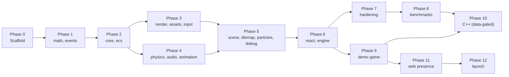

# Flare Engine — Build Plan Overview

> Engine: **Flare** — modular 2D game engine for React Native on Skia
> Package scope: `@flare/*`
> Monorepo: Bun + Turborepo + Biome

---

## Phase Summary

| Phase                 | Packages                                 | Depends on | Status           | Milestone                                                      |
| --------------------- | ---------------------------------------- | ---------- | ---------------- | -------------------------------------------------------------- |
| 0 — Repo scaffold     | —                                        | —          | ✅ DONE          | `bun install` works, `turbo build` runs, hooks enforce commits |
| 1 — Foundation        | `math`, `events`                         | —          | ✅ DONE          | All math/event primitives, full test coverage                  |
| 2 — Core Runtime      | `core`, `ecs`                            | Phase 1    | ✅ DONE          | GameLoop, ECS, coroutines, pooling working                     |
| 3 — Rendering + Input | `render`, `assets`, `input`              | Phase 2    | ✅ DONE          | 100+ sprites at 60fps on device                                |
| 4 — Systems           | `physics`, `audio`, `animation`          | Phase 2    | ✅ DONE          | Collisions, audio, tweens working                              |
| 5 — Features          | `scene`, `tilemap`, `particles`, `debug` | Phase 3+4  | ✅ DONE          | Tiled maps, particles, scenes, dev overlay                     |
| 6 — Integration       | `react`, `engine`                        | Phase 5    | ✅ DONE          | Full example game on iOS + Android                             |
| 7 — Hardening         | —                                        | Phase 6    | ✅ DONE (pass 1) | Audit, optimize, fix gaps, stress-test all APIs                |
| 8 — Benchmarking      | `benchmarks/` + `apps/bench-dashboard/`  | Phase 7    | 🟡 in progress  | Microbench + integration bench + dashboard done; device capture pipeline ready, awaiting hardware run |
| 9 — Demo Game         | `apps/demo`                              | Phase 6    | ✅ DONE         | Full loop verified on device: menu → play → boss → game-over/victory → menu |
| 10 — C++ Acceleration | `native`                                 | Phase 8+9  | ⬜ data-gated    | C++ via Nitro only where benchmarks show need (particles first)|
| 11 — Web Presence     | —                                        | Phase 9    | ⬜ planned       | Landing page, embedded demo video, dev blog                    |
| 12 — Launch           | —                                        | Phase 11   | ⬜ planned       | LinkedIn + Reddit + RN forums, content series, personal brand  |

---

## Phase Details

### Phase 0 — Repository Scaffold

1. **Init**: `bun init`, root `package.json` with `workspaces: ["packages/*"]`
2. **Turborepo**: `turbo.json` — pipelines: `build`, `test`, `lint`, `typecheck`
3. **Biome**: `biome.json` — 2-space indent, 100 line width, single quotes, recommended rules, import sorting
4. **TypeScript**: `tsconfig.base.json` — strict, ES2022, bundler resolution, verbatimModuleSyntax
5. **Conventional commits**: commitlint + husky commit-msg hook
   - Types: feat, fix, perf, refactor, test, docs, build, ci, chore
   - Max header: 72 chars
   - No emoji in subject
   - Scope = module name: `feat(math): add Vec2.lerp`
6. **Lint-staged**: husky pre-commit → `biome check --write`
7. **Changesets**: `.changeset/config.json` — restricted access, independent versioning
8. **Build**: `tsup` per package (dual CJS+ESM, .d.ts)
9. **CI**: GitHub Actions — `ci.yml` (PR only; release workflow removed — repo is private)
10. **Docs**: README.md (Mermaid arch diagram), CONTRIBUTING.md, LICENSE (MIT)
11. **Package stubs**: 16 empty packages under `packages/`

### Phase 1 — Foundation

**`@flare/math`** (zero deps, < 5KB)

- Vec2 (as `{x,y}` objects + static zero-alloc methods), Rect, Circle, Transform2D
- Mat3 on Float32Array
- Color (RGBA, lerp, hex conversion)
- 42 easing functions (tree-shakeable named exports)
- Random (seeded RNG, distributions)
- Intersection tests (rect/circle/point/line)
- Scalar utils (clamp, lerp, inverseLerp, map, degToRad, radToDeg)

**`@flare/events`** (zero deps, < 1KB)

- EventEmitter\<EventMap\> with type-safe generics
- Signal\<T\> for single-event pattern

**Tests:** Full coverage. Edge cases: NaN, Infinity, zero vectors, degenerate rects.

### Phase 2 — Core Runtime

**`@flare/core`**

- GameLoop (fixed + variable timestep, accumulator pattern)
- Clock (dt, elapsed, fps, timescale, frame counter)
- AppLifecycle (RN AppState → auto-pause, dt cap on resume)
- ScreenManager (FIT/FILL/STRETCH, safe area, pixel ratio)
- Coroutines (generator-based: yield seconds, yield frame, yield Promise)
- Pool\<T\> (acquire, release, prewarm)

**`@flare/ecs`**

- World, defineComponent, defineSystem, Query (archetype bitmask)
- Prefab factory
- Built-in components: Position, Velocity, Rotation, Scale, Parent
- Lightweight FSM (onEnter, onExit, onUpdate, transitions)
- Optional SoA storage for hot components

**Tests:** Loop timing, coroutine sequencing, ECS query correctness, pool lifecycle.

### Phase 3 — Rendering + Input

**`@flare/render`**

- SpriteBatch (Skia Atlas wrapper, auto-batch by texture)
- Camera2D (follow, shake, bounds, worldToScreen/screenToWorld)
- RenderSystem (ECS integration: query Position+Sprite → sort → batch draw)
- SpriteEffects (tint, flash, grayscale via Skia BlendColor/ColorMatrix)
- SpriteFont (BMFont parser → atlas text rendering)

**`@flare/assets`**

- AssetManager (manifest-based loading, progress tracking)
- SpriteSheet parser (TexturePacker JSON hash+array, Aseprite JSON)
- Texture wrapper (Skia SkImage)

**`@flare/input`**

- InputManager (polling + events, per-frame snapshot)
- Pointer/Touch tracking
- VirtualJoystick (React component + data)
- VirtualButton (React component + data)
- Gesture handlers (tap, swipe, pinch, long press)

**Verification:** Example RN app rendering 100+ sprites via Atlas at 60fps on real device.

### Phase 4 — Systems (parallel with Phase 3 where possible)

**`@flare/physics`**

- AABB CollisionWorld (broadphase + resolution)
- SpatialIndex (rbush wrapper, query API)
- Collider component (trigger, layer, mask)
- Collision signals
- Raycast
- planck.js integration layer (optional tier)

**`@flare/audio`**

- AudioManager (react-native-audio-api)
- SFXPool (pre-decoded, polyphony management)
- Music (crossfade, loop)
- Volume channels

**`@flare/animation`**

- SpriteAnimator (tick-based, renderer-agnostic)
- Tween (42 easings, chainable)
- Spring (configurable stiffness/damping/mass)
- TweenManager, Timeline (sequence/parallel/stagger)

### Phase 5 — Features

**`@flare/scene`**

- SceneManager (register, go, push/pop stack)
- Scene base class (own World + Camera, lifecycle hooks)
- Transitions (fade, slide, none)

**`@flare/tilemap`**

- Tiled .tmj parser (orthogonal, tile/object layers)
- LDtk parser (levels, entities)
- TilemapRenderer (culled, Atlas-batched)
- TilemapCollider (extract solid tiles → shapes)

**`@flare/particles`**

- ParticleEmitter (configurable: rate, lifetime, speed, color, size, alpha)
- ParticlePool (pre-allocated, zero GC)
- Immediate-mode Skia rendering

**`@flare/debug`**

- Overlay: collision bounds, velocity vectors, entity origins
- Stats: FPS, entity count, draw calls
- Time controls: pause, step, slow-motion
- Entity inspector (tap to log)
- All wrapped in `__DEV__` guards

### Phase 6 — Integration

**`@flare/react`**

- `<GameView>` (Skia Canvas + loop + input)
- `<VirtualJoystick>`, `<VirtualButton>` (overlay RN components)
- `useGame()`, `useEntity()`, `useGameLoop()`
- `<LoadingScreen>`

**`@flare/engine`**

- `createGame(config)` convenience
- Re-exports all packages

**Verification:** Complete example game (top-down shooter or platformer). Build + run on iOS + Android.

### Phase 7 — Hardening

Pass 1 (done, 2026-04-16):

- [x] Audited all 16 packages against API spec — gaps catalogued and filed
- [x] Fixed bugs: ScreenManager safe-area insets, slideTransition direction + kind discriminator, GameInstance.batch surface
- [x] Zero-alloc pass on hot paths: CollisionWorld.step (packed pair keys + swap-buffer Sets), RenderSystem (sort prefix in place), Camera2D (worldToScreenInto / screenToWorldInto / getBoundsInto), ParticlePool.getColor (shared + Into variant), TilemapRenderer (reused bounds buf, inlined src-rect math)
- [x] Reconciled `docs/design/api-specs.md` with shipping symbols; flagged deferred items (planck.js tier, MMKV audio persistence)

Pass 2 (done, 2026-04-16):

- [x] Cross-package integration bench (`benchmarks/src/integration.bench.ts`) — `world.step + coll.step + emitter.update + sortByDrawOrder + batch.flush` over 500/1K/2K entities + 300 particles.
- [x] Heap delta check (post-GC, 500 frames). Found per-frame `world.query()` allocation in the integration bench itself; fixed by hoisting the query. Residual heap noise traces to documented `CollisionWorld` pair string keys (acceptable design tradeoff).
- [x] API ergonomics finding: every consumer of `world.query()` should pre-create the query in setup, not per-frame. Already followed by the demo (`apps/demo/src/scenes/play.ts`); reaffirmed in `packages/ecs/CLAUDE.md` consumers.
- Bugs from demo development — none from M2/M3 itself; device playtest later surfaced three integration-layer fixes (audio cleanup on scene exit, screen-space camera centering, RN touch-responder propagation through `<GameView>`). All fixes landed in `apps/demo` + `@flare/react`; engine layers below `react`/`engine` untouched.

Audit — api-specs.md vs shipping exports (2026-04-16):

- ✅ Reconciled stale spec names: `SpriteFont` → BMFont text cluster, `VirtualJoystick`/`VirtualButton` RN component location (in `@flare/react`, not `@flare/input`), `Channels` → `createChannels`, `tickAnimator` → `updateAnimator`, `TiledParser`/`LDtkParser`/`TilemapCollider` → `parseTiled`/`parseLDtk`/`extractColliders`.
- ⏸ `_resetComponentIds` exported from `@flare/ecs` as test seam — underscore-prefix convention signals internal; consumed by `benchmarks/` and `@flare/engine` integration tests. Keeping as-is.
- ⏸ `QueryBuilder` (`@flare/ecs`), `drawOrderCompare` (`@flare/render`), `shapeOverlap` (`@flare/physics`), `createSkiaFrameRenderer` (`@flare/react`) — undocumented additions, working as designed. Low priority to document.
- No `TODO` / `FIXME` in `packages/*/src/**/*.ts` hot-path code.

### Phase 8 — Benchmarking

Off-device microbenches (done, 2026-04-16):

- [x] Bench harness + workspace package at `benchmarks/` — Bun-only, zero Skia/RN
- [x] ECS `world.step` at 500 / 1K / 2K / 5K entities (Pos + Vel move system)
- [x] Physics `CollisionWorld.step` + position updates at 100 / 500 / 1K AABBs, sparse + dense
- [x] Particles `emitter.update` — integrate-only and emit+integrate at 500 / 1K / 2K / 5K
- [x] Render `SpriteBatch.flush` at 100 / 500 / 1K sprites with 1 / 4 / 8 atlases; `sortByDrawOrder` with 0 / 5 / 10 swaps
- [x] Integration bench (Phase 7 pass 2): combined-frame steady state at 500/1K/2K entities + 300 particles, plus heap delta check
- [x] Results written to `docs/references/benchmarks.md` (with headline numbers box) and structured `benchmarks/results/microbench.json` for the dashboard
- [x] Root `bun run bench` runs the suite (also writes JSON automatically)

Device-side measurements (capture pipeline ready, awaiting hardware run):

- [x] FPS overlay mounted in demo HUD (long-press top-right to toggle)
- [x] Bench scene at `apps/demo/src/scenes/bench.ts` — three load levels (light/medium/heavy = 10/30/50 enemies + 50/150/300 bullets), 10s each, samples FPS once per second, dumps CSV to console between BENCH FPS CSV BEGIN / END markers
- [x] Hidden triple-tap on menu title launches bench scene
- [x] `benchmarks/results/device.json` schema + dashboard `/device` route ready to consume hand-filled samples
- ⏸ User to run on iOS + Android hardware, copy console CSV, populate `benchmarks/results/device.json`, then `bun run bench:md` regenerates `docs/references/benchmarks.md` device section
- ⏸ Audio SFXPool polyphony limits (needs device audio pipeline)
- ⏸ Memory / GC pressure in steady-state on device

Outputs gate Phase 10 — C++ only where measured speedup justifies complexity. Current signal from microbenches: physics is the clear outlier (~11 ms per step at 1K AABBs), matching the `<1000 dynamic entities` note in `packages/physics/CLAUDE.md`.

### Phase 9 — Demo Game

**Genre** — vertical-scrolling shoot-em-up in the style of *Raptor: Call of the Shadows*. One playable level as a showcase (not a full game): player ship at bottom firing upward, enemies descending in waves with simple patterns, a boss at the end. Chosen over a platformer because it exercises more engine surface simultaneously (many projectiles → particles, multi-directional collision, ranged combat, enemy spawn patterns, boss fight).

**Special mechanic** — bomb skill: clears all non-boss enemies + enemy projectiles on screen, deals 25% HP to the boss. Limited charges per run.

**Stack** — Expo managed workflow + React Native + `@shopify/react-native-skia` + `react-native-audio-api` + `react-native-gesture-handler`, wired through `@flare/engine`. No bare RN.

**Assets** — user will drop in [Kenney "Space Shooter Redux"](https://opengameart.org/content/space-shooter-redux) (CC0) as the final atlas. Initial scaffold uses a procedurally-generated placeholder atlas (colored rects drawn into an SkImage at init) so gameplay is playable before art lands. Swapping atlas = replace one asset loader + regenerate `SpriteFrame` entries.

**Scope** — one level with:

- Player ship, joystick movement, auto-fire upward, HP
- Enemy waves with 2–3 simple patterns (straight-down, sine, diagonal)
- Enemy projectiles
- Bomb skill (above), limited charges, HUD counter
- Boss at end of wave list with distinct HP bar and attack pattern
- Particle effects: muzzle flash, hit flash, explosions, thruster
- HUD: score, player HP, bomb count, boss HP (when active)
- Win / game-over states
- FPS overlay via `@flare/debug` (toggleable)

**Systems covered** — ECS, physics (AABB vs AABB + trigger signals), particles, audio (SFX + music), animation (tweens for hit flash, spring for HUD pops), scene manager (menu → play → victory/game-over), input (joystick + button), debug overlay.

**Location** — `apps/demo/` inside this monorepo. Added as a new workspace root (`apps/*`).

**Verification** — user runs on iOS + Android hardware. Target: stable 60 fps. Flare dev work on this branch is complete when the app typechecks, builds, and launches in Metro. Device FPS captures feed back into Phase 8's device section and Phase 7 pass 2.

**Deliverable** — game recordings of the level + boss fight used as landing-page demo content in Phase 11.

**Milestones:**

- **M1 Scaffold (done)** — `apps/demo` Expo app boots an empty `<GameView>` on device. Root workspaces grown to `apps/*`. Engine gaps filled: `<LoadingScreen>` (`@flare/react`), `createProceduralAtlas` (`@flare/assets`), `createFpsWidget` (`@flare/debug`).
- **M2 Gameplay (done, device verification pending)** — player + joystick + auto-fire, enemy waves with 2–3 patterns, enemy projectiles, HUD, collisions, win/game-over scenes.
- **M3 Boss + polish (done, 2026-04-16)** — bomb skill, boss FSM, audio pass (music + polished SFX), and FPS overlay landed. Kenney art swap deferred; device FPS capture gated on user hardware run (bench scene + JSON pipeline ready).
- **Device playtest (done, 2026-04-16)** — full loop runs on device: menu → play → boss fight → game-over/victory → back to menu. Three blocking playtest bugs fixed: SFX leaking across scene transitions (now `SFXPool.stopAll()` on play `onEnter`/`onExit`), camera origin off-screen (each scene now centers `Camera2D` to `viewport/2` so screen-space spawns line up with the centered-origin convention in `Renderer.applyCamera`), and joystick/bomb-button touches hijacked by parent `<GameView>` responder (`VirtualJoystick` and `VirtualButton` now claim the RN responder via `onStartShouldSetResponder` so touches inside their bounds bypass the parent). Joystick coordinate-space bug also fixed (now uses view-relative `locationX/locationY` instead of mixed page/parent coords).

### Phase 10 — C++ Acceleration (data-gated)

- Only start after Phase 8 benchmarks identify actual bottlenecks
- Priority order (per `docs/design/native-acceleration.md`):
  1. Particle simulation (highest speedup, lowest effort — ~50 LOC C++)
  2. ECS hot loop iteration
  3. Spatial hash grid
  4. Physics (Box2D C++ — only if planck.js is measured bottleneck)
- Nitro Modules + zero-copy Float32Array architecture
- Background thread game logic via `react-native-worklets-core` (optional)

### Phase 11 — Web Presence

- Landing page: describe the engine, show architecture, link to blog
- Demo content: screen recordings or GIFs of the Phase 9 game
- Dev blog: post series documenting build decisions (ECS design, zero-alloc patterns, Skia atlas tricks, etc.)
- Tutorials: getting started guide — not exhaustive, enough to hook developers
- Stack: static site (Astro or similar) — separate repo, repo stays private

### Phase 12 — Launch & Personal Brand

- LinkedIn post: engine announcement with demo video + blog link
- Reddit: r/reactnative, r/gamedev — technical post (not just self-promotion)
- React Native community: RN Discord, React Native Radio, Expo forums
- Content series: follow-up posts on specific systems (ECS, particles, physics)
- Goal: establish personal brand as the person who built a game engine on RN

---

## Dependency Chain

---

## References

- [Architecture](../design/architecture.md) — layered module design
- [API specs](../design/api-specs.md) — per-module API tables
- [Ecosystem](../design/ecosystem.md) — competitive context
- [Native acceleration](../design/native-acceleration.md) — Phase 7 C++ strategy
- [Dependencies](../design/dependencies.md) — key deps and choices
- [Tooling decisions](tooling.md) — Bun, Biome, Turborepo rationale
